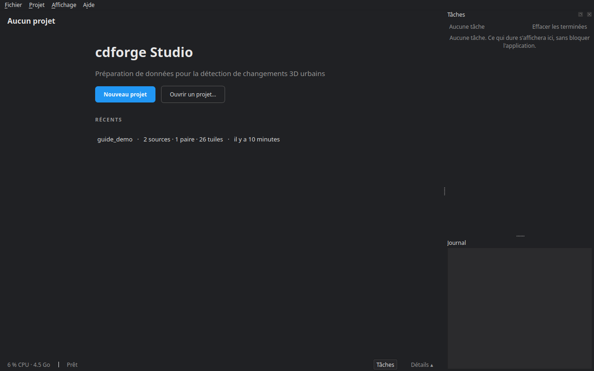
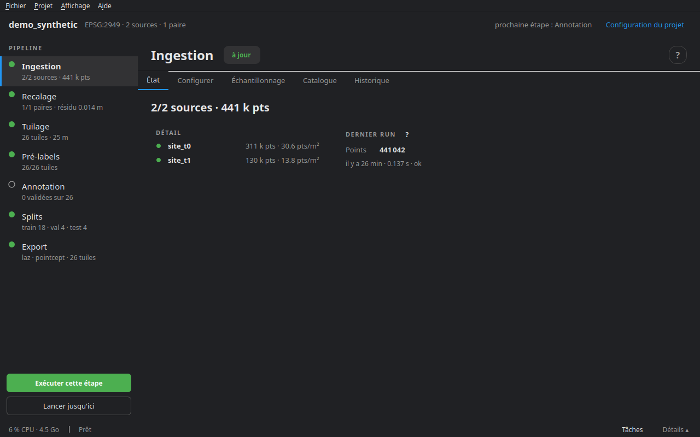

# Prise en main

cdforge prépare des jeux de données de détection de changements 3D : deux relevés d'un même lieu, à deux dates, deviennent des tuiles où chaque point porte une classe sémantique (ce qu'il est) et une classe de changement (ce qui lui est arrivé). cdforge Studio est l'interface qui mène tout le traitement, de la lecture des fichiers à l'export.

## Lancer cdforge Studio

Depuis un terminal :

```bash
cdforge studio
```

Avec l'AppImage, double-cliquer sur le fichier `cdforge-<version>-x86_64.AppImage` (après l'avoir rendu exécutable), ou :

```bash
./cdforge-<version>-x86_64.AppImage
```

`cdforge install-launcher` ajoute cdforge Studio au menu des applications, avec son icône.

## L'écran d'accueil



Sans projet ouvert, la fenêtre propose **Nouveau projet** (l'assistant de création, voir [Créer et configurer un projet](02_projet.md)), **Ouvrir un projet…** (choisir le dossier qui contient `project.yaml`) et la liste des projets **récents**, avec leurs sources, paires et tuiles.

## L'espace de travail



Un projet ouvert se présente en trois bandes.

**L'en-tête**, en haut : le nom du projet, son système de coordonnées, le nombre de sources et de paires, la **prochaine étape** à faire, et le lien **Configuration du projet**.

**La colonne du pipeline**, à gauche : les sept étapes, dans l'ordre.

1. **Ingestion** — lire les sources, rogner, uniformiser les labels.
2. **Recalage** — aligner la seconde époque sur la première.
3. **Tuilage** — découper chaque paire sur une grille commune.
4. **Pré-labels** — proposer automatiquement le changement et la sémantique.
5. **Annotation** — corriger et valider, tuile par tuile, dans l'éditeur.
6. **Splits** — répartir les tuiles en train, validation et test.
7. **Export** — écrire le jeu de données.

Chaque étape montre une pastille d'état — à jour, non exécutée, **périmée** (sa configuration a changé depuis le dernier run), en échec — et un résumé (« 26 tuiles · 25 m »). Sous la colonne, **Exécuter cette étape** lance l'étape sélectionnée et **Lancer jusqu'ici** enchaîne toutes celles qui la précèdent, elle comprise. L'annotation ne se lance pas en lot : sur cette étape, le bouton devient **Ouvrir l'éditeur d'annotation**.

**Le panneau de l'étape**, au centre, en onglets :

- **État** : le résumé, le détail par source, paire ou tuile, et les métriques du dernier run ;
- **Configurer** : les réglages de l'étape, écrits dans `project.yaml` ;
- des onglets propres à certaines étapes : **Échantillonnage** et **Catalogue** (ingestion), **Carte des tuiles** (tuilage), **Contrôle qualité** (pré-labels), **Éditeur** (annotation), **Évaluation** (export) ;
- **Historique** : chaque run, sa durée, son statut, ses métriques et les paramètres avec lesquels il a tourné.

Le bouton **?**, à droite du titre, ouvre le chapitre de ce guide consacré à l'étape.

**La barre du bas** affiche l'occupation du processeur et de la mémoire, le dernier message, le bouton **Tâches** et le bouton **Détails**, qui déplie le panneau de détails.

## Les menus

**Fichier** — Nouveau projet (Ctrl+N), Ouvrir un projet… (Ctrl+O), Quitter (Ctrl+Q).

**Projet** — Exécuter tout le pipeline (l'équivalent de `cdforge run` : les étapes s'enchaînent, celles qui sont à jour sont sautées) ; Rafraîchir l'état (F5) ; Configuration du projet ; Classes du projet… ; Classes de changement….

**Affichage** — thème sombre ou clair ; panneau de détails (Ctrl+J) ; panneau des tâches (Ctrl+T) ; détacher les tâches dans une fenêtre ; **Langue / Language** : le studio propose de redémarrer dans la langue choisie, et rouvre le même projet.

**Aide** — Guide de l'utilisateur (F1), Démos interactives, les documents d'explication (comment le pré-label décide d'un changement, l'assistance sémantique SNAP, annoter les deux dates), Module IA…, À propos.

## Les notions

**Projet** — un dossier : `project.yaml` (toute la configuration), `raw/` (un emplacement pour les sources, qui peuvent aussi rester ailleurs), `work/` (fichiers intermédiaires : sources ingérées, recalage, tâches), `tiles/` (les tuiles), `exports/`, `reports/`, et `splits.json` une fois la répartition faite.

**Source** — un relevé : un fichier ou plusieurs bandes fusionnées, avec son capteur (MLS, ULS, ALS, TLS…), son site, sa date, et éventuellement une trajectoire du capteur et un schéma qui dit comment lire ses classes.

**Paire** — deux sources d'un même site : **t0**, la plus ancienne, et **t1**, la plus récente. Elles sont recalées puis tuilées ensemble.

**Tuile** — un carré de la grille commune, avec les points des deux époques. Son **cœur** n'appartient qu'à elle ; son **tampon** déborde sur ses voisines, pour que les calculs près du bord voient le contexte.

**Labels** — chaque point a deux couches d'étiquettes :

- la **sémantique** : la classe de l'objet, dans la liste de classes du projet (voir [Classes](02_projet.md#les-classes)) ;
- le **changement** : *unchanged* (inchangé), *added* (ajouté, points de t1), *removed* (supprimé, points de t0), *transient* (objet de passage) et *unobserved* (non observé : l'autre époque ne voyait pas l'endroit). *unobserved* est rangé sous *unchanged* : rien n'y a été vu changer.

Chaque étiquette garde sa **provenance** : aucune, importée de la vérité terrain d'une source, proposée automatiquement, ou posée par une personne. Un label automatique ne passe jamais pour un label validé.

## Raccourcis de l'espace de travail

| Touche | Action |
|---|---|
| Ctrl+N | Nouveau projet |
| Ctrl+O | Ouvrir un projet |
| F5 | Rafraîchir l'état |
| Ctrl+J | Panneau de détails |
| Ctrl+T | Panneau des tâches |
| F1 | Ce guide |
| Ctrl+Q | Quitter |

L'annotateur a ses propres raccourcis : voir [Annotation](08_annotation.md).

## Et ensuite

Pour essayer sans données, `cdforge demo` crée un projet synthétique aux changements connus et le traite de bout en bout ; ouvrez-le ensuite dans le studio. Pour vos propres relevés, commencez par [Créer et configurer un projet](02_projet.md).
