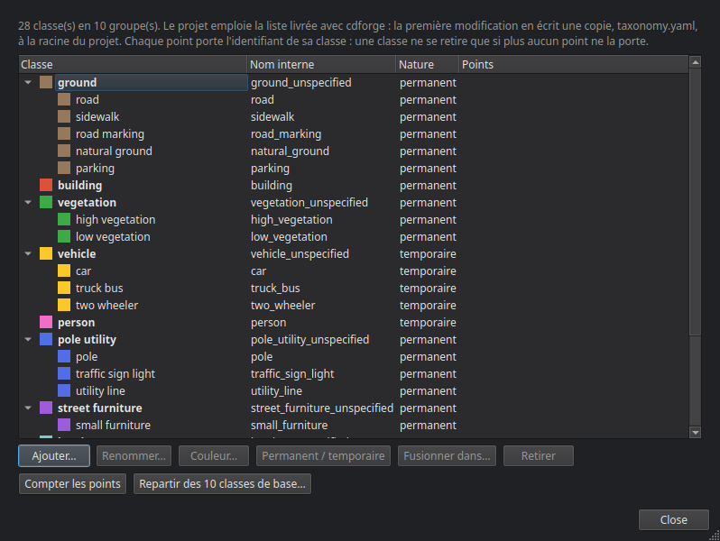
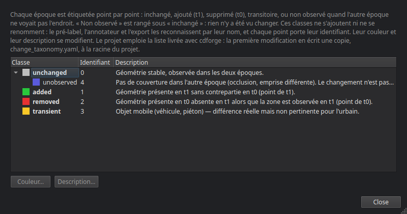

# Créer et configurer un projet

Un projet cdforge est un dossier dont toute la configuration tient dans `project.yaml`. On le crée avec l'assistant (**Fichier ▸ Nouveau projet**), ou en ligne de commande avec `cdforge init`, puis on le règle dans la fenêtre **Configuration du projet**.

## L'assistant de création

Cinq pages.

### 1. Informations de base

Le **nom** du projet, une **description** facultative et le **dossier** où le créer. L'assistant y prépare `raw/`, `work/`, `tiles/`, `exports/` et `logs/`.

### 2. Système de coordonnées

Le **CRS** du projet, par code EPSG — saisi, cherché par nom (avec l'option `cdforge[crs]`), ou **lu dans un fichier** : un LAS/LAZ qui en porte un, ou le `.prj` posé à côté d'un fichier. Beaucoup de fichiers n'en ont pas (un PLY n'a pas où le mettre) ; cdforge le dit, et ne devine pas à votre place un CRS dont il ne connaît que le nom. Un relevé en repère local (TLS, SLAM) n'a pas de projection : choisissez **Aucun CRS (coordonnées locales)**, et les exports n'en porteront pas.

Le **datum vertical** : CGVD2013, CGVD28, NAVD88, hauteur ellipsoïdale WGS84, ou « inconnu (à documenter) ».

### 3. Sources de données

**Ajouter des fichiers…** ou **Ajouter un dossier…** (un dossier de tuiles `.npy` façon Pointcept, par exemple). Plusieurs fichiers ajoutés ensemble : l'assistant demande s'il s'agit de **bandes d'une même source**, à fusionner, ou de **sources distinctes**.

Pour chaque source :

- **ID** — unique dans le projet ;
- **Capteur** — MLS, ALS, ULS, TLS, SYN (synthétique) ou other ;
- **Site** et **Époque** (par exemple `2023-06`) — deux sources du même site forment une paire ;
- **Schéma sémantique** — comment lire les classes que porte le fichier (`asprs_las14`, `toronto3d`, `semantickitti19`…) ; vide si le fichier n'a pas de classes ;
- **Schéma de changement** — pour un fichier qui porte déjà des labels de changement (`urb3dcd_v2`) ; vide sinon ;
- **Trajectoire** — facultative : le fichier CSV des positions du capteur. Elle permet au pré-label de lancer des rayons du capteur vers les points (voir [Pré-labellisation](06_prelabel.md)).

Une source peut n'avoir aucun label : c'est le cas général, et les pré-labels sont là pour ça. Si les fichiers ajoutés ne portent pas le même CRS, ou pas celui déclaré à la page précédente, l'assistant l'affiche : rien en aval ne le rattraperait.

### 4. Paires de détection

Les sources qui partagent un site sont appariées d'office : la plus ancienne en **t0**, la plus récente en **t1**. **+ Ajouter une paire manuellement** pour les autres cas. Un projet purement sémantique peut n'avoir aucune paire.

### 5. Récapitulatif

Tout ce qui sera écrit, et la case **Lancer l'ingestion immédiatement**.

## La configuration du projet

Le lien **Configuration du projet** de l'en-tête (ou **Projet ▸ Configuration du projet**) ouvre une fenêtre à onglets.

- **Général** — nom, version du format, CRS, dossier ; la description se modifie ici.
- **Sources** — la liste des sources ; **Ajouter une source** (mêmes champs que dans l'assistant, avec des chemins de fichiers séparés par des virgules) et **Retirer**.
- **Paires** — **Créer une paire** (t0, t1) et **Retirer la paire sélectionnée**.
- **Classes** — la liste de classes sémantiques du projet (ci-dessous).
- **Classes de changement** — leurs couleurs et descriptions (ci-dessous).
- **Paramètres** — les réglages de chaque étape, en lecture seule : ils se modifient dans l'onglet **Configurer** de chaque étape, ou dans l'onglet YAML.
- **YAML** — `project.yaml` tel quel. **Sauvegarder le YAML** vérifie le fichier avant de l'écrire : un fichier invalide n'est pas enregistré.

## Les classes

**Projet ▸ Classes du projet…**, ou l'onglet **Classes** de la configuration.



Chaque projet part de **10 classes de base** : ground, building, vegetation, vehicle, person, pole_utility, street_furniture, barrier, water, other. Les noms sont en anglais, et c'est le nom affiché. L'assistant et `cdforge init` les écrivent dans `taxonomy.yaml`, à la racine du projet ; un projet qui pointe encore vers une liste livrée avec cdforge en reçoit une copie à la première modification — la liste du paquet n'est jamais modifiée.

- **Ajouter…** — une classe plus fine **sous une classe de base** (`street_light` sous `pole_utility` : l'export en classes de base la compte dans son groupe), ou une **nouvelle classe de base** (`rail`) ; il faut alors dire si ce qu'elle désigne est **permanent** ou **temporaire**.
- **Renommer…** — l'ancien nom reste compris : les traductions de schéma qui le citent visent toujours cette classe.
- **Couleur…**
- **Permanent / temporaire** — vaut pour tout le groupe. Dans l'annotateur, un changement porté par une classe temporaire (un véhicule garé à t0, parti à t1) peut être requalifié en *transient*.
- **Fusionner dans…** — remappe une classe vers une autre sur tout le projet : chaque point qui la porte, dans toutes les couches de toutes les tuiles, passe à l'autre ; puis elle quitte la liste.
- **Retirer** — seulement si plus aucun point ne la porte. **Compter les points** parcourt les étiquettes de toutes les tuiles pour le savoir. Un point stocke l'identifiant de sa classe : la retirer sous lui le rendrait « hors taxonomie » sans que rien ne le signale.
- **Repartir des 10 classes de base…** — garde celles que des points portent encore.

Un modèle sémantique peut prédire des classes que la liste n'a pas : c'est à l'harmonisation du modèle qu'on les ajoute ou qu'on les range (voir [Modèles sémantiques](07_ia.md)).

## Les classes de changement

**Projet ▸ Classes de changement…**, ou l'onglet du même nom.



Cinq classes, aux identifiants fixes : *unchanged* (0), *added* (1), *removed* (2), *transient* (3), *unobserved* (4), cette dernière rangée sous *unchanged*. Elles ne s'ajoutent ni ne se renomment : le pré-label, l'annotateur et l'export les reconnaissent par leur nom. Leur **couleur** et leur **description** se modifient ; comme pour les classes sémantiques, la première modification écrit une copie dans le projet, `change_taxonomy.yaml`.

## En ligne de commande

```bash
cdforge init mon_projet       # project.yaml commenté et dossiers
cdforge validate mon_projet   # vérifie project.yaml, les fichiers sources et les schémas
```

Étape suivante : [Ingestion](03_ingestion.md).
