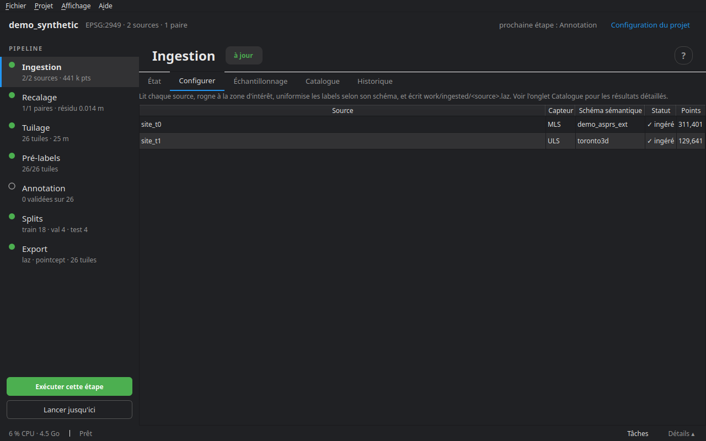
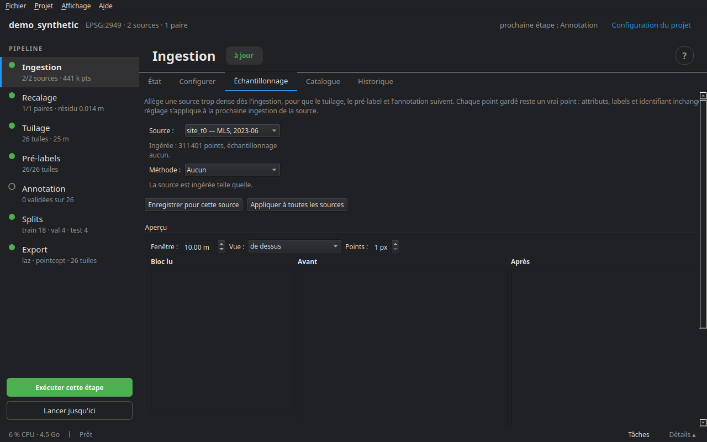

# Ingestion

L'ingestion lit chaque source, la rogne à la zone d'intérêt, uniformise ses labels selon son schéma et écrit une version standard, `work/ingested/<source>.laz`, avec ses statistiques à côté (`<source>.json`). Toutes les étapes suivantes partent de là.

## Les formats lus

| Format | Extensions | Remarque |
|---|---|---|
| LAS, LAZ | `.las`, `.laz` | classes, intensité, couleur, temps GPS, dimensions supplémentaires ; le CRS s'il y est écrit |
| PLY | `.ply` | ASCII ou binaire |
| E57 | `.e57` | tous les scans du fichier, chacun replacé par sa pose ; les tirs sans retour sont écartés |
| PCD | `.pcd` | ASCII ou binaire (pas la variante compressée) |
| PTS | `.pts` | ligne de compte, puis `x y z [intensité] [r g b]` |
| PTX | `.ptx` | chaque scan est replacé par sa matrice ; les tirs sans retour sont écartés |
| Texte | `.txt`, `.xyz`, `.csv`, `.asc` | une ligne d'en-tête nomme les colonnes ; sans elle, les trois premières sont x, y, z |
| NPZ | `.npz` | tableaux NumPy nommés |
| Dossier `.npy` | un dossier | à la manière de Pointcept : `coord.npy`, `color.npy`, `segment.npy`… |

Plusieurs fichiers d'une même source — des bandes d'un relevé mobile, par exemple — sont fusionnés en une seule source.

## Les schémas : lire les classes d'une source

Un fichier qui porte déjà des classes les numérote à sa façon. Le **schéma sémantique** de la source dit à quelle classe du projet correspond chacun de ses codes. cdforge en livre pour ASPRS LAS 1.4, DALES, Paris-Lille-3D, SensatUrban, Toronto-3D, SemanticKITTI, nuScenes, Waymo et quelques autres ; `cdforge validate` vérifie le projet, ses fichiers et ses schémas. Le **schéma de changement** fait de même pour une source qui porte des labels de changement (Urb3DCD).

Sans schéma, la source est lue comme de la géométrie seule : ce sont les pré-labels qui proposeront les classes.

## L'onglet Configurer



La liste des sources, avec leur capteur, leur schéma sémantique, leur statut (en attente, ingérée) et leur nombre de points. Les sources elles-mêmes se déclarent dans la **Configuration du projet** (voir [Créer et configurer un projet](02_projet.md)). **Exécuter cette étape** ingère celles qui ne le sont pas encore, ou dont le réglage a changé.

## L'onglet Échantillonnage



Allège une source trop dense dès l'ingestion, pour que le tuilage, le pré-label et l'annotation suivent. Chaque point gardé reste un vrai point : ses attributs, ses labels et son identifiant ne changent pas.

| Méthode | Ce qu'elle garde |
|---|---|
| **Aucun** | tout : la source est ingérée telle quelle |
| **Aléatoire** | chaque point avec la probabilité choisie ; la même graine garde les mêmes points |
| **Un point sur N** | dans l'ordre du fichier — sur un relevé mobile, l'ordre d'acquisition. Le plus rapide |
| **Voxel** | un point par cube de l'arête choisie : n'allège que là où c'est plus dense que la grille |
| **FPS** (point le plus éloigné) | à chaque pas, le point le plus éloigné de ceux déjà gardés : l'espacement le plus régulier, calculé par groupes de points voisins |

L'**aperçu** applique le réglage au premier bloc de la source, vu de dessus ou en coupe, avant et après : points dans la fenêtre, densité, espacement médian, et une estimation pour toute la source. **Enregistrer pour cette source**, ou **Appliquer à toutes les sources** — t0 et t1 allégées de la même façon. Si les deux époques d'une paire ne le sont pas, l'onglet le signale : une différence de densité peut se lire comme un changement. L'ingestion suivante refait les sources dont le réglage a changé.

## L'onglet Catalogue

Une ligne par source ingérée : site, époque, capteur, nombre de points, densité, et sa **trajectoire**. **Trajectoire…** associe à une source le fichier CSV des positions de son capteur, ou le retire. **Exporter la fiche du jeu de données** écrit et ouvre `reports/report.html` : sources, recalage, labels, journal des traitements.

## L'onglet État

Pour chaque source : le nombre de points et la densité (points/m²) ; puis les métriques du dernier run.

## En ligne de commande

```bash
cdforge ingest mon_projet
```

Étape suivante : [Recalage](04_recalage.md).
