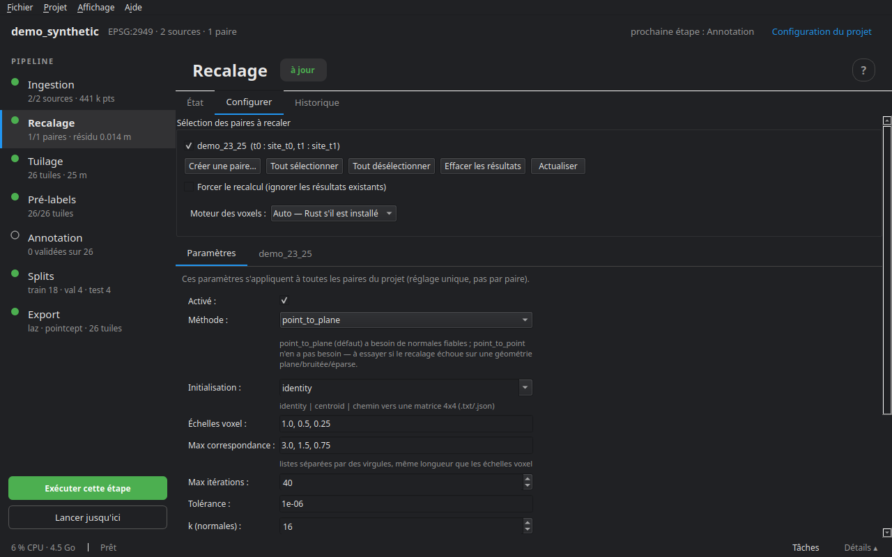

# Recalage

Deux relevés d'un même lieu ne tombent jamais exactement l'un sur l'autre : dérive du positionnement, calibration, géoréférencement. Le recalage cherche la transformation rigide (rotation et translation) qui amène **t1 sur t0**. Elle est écrite dans `work/align/<paire>.json` ; les fichiers ingérés ne sont pas réécrits, c'est le tuilage qui l'applique aux points de t1.

Sans recalage, un mur qui n'a pas bougé apparaît décalé de quelques centimètres, et le pré-label le prend pour un changement.

## Comment il procède

Une ICP (*iterative closest point*) robuste, à plusieurs échelles :

1. les deux époques sont lues en entier et amincies sur une grille de voxels — c'est la phase la plus longue sur un gros relevé ;
2. l'ICP tourne d'abord à l'échelle la plus grossière, puis affine : à chaque échelle (`voxel_scales`, par défaut 1 ; 0,5 ; 0,25 m), une correspondance n'est retenue qu'en deçà d'une distance maximale (`max_corr`, 3 ; 1,5 ; 0,75 m) ;
3. une pondération robuste (Tukey par défaut, ou Huber) écarte ce qui a vraiment changé, qui ne doit pas tirer la transformation.

À la fin, la **NMAD des résidus** (une mesure robuste de leur dispersion) est retenue comme **erreur de recalage** : c'est elle qui entre, par défaut, dans le seuil de détection du pré-label (voir [Pré-labellisation](06_prelabel.md)).

## L'onglet Configurer



**Sélection des paires à recaler**, avec **Tout sélectionner**, **Tout désélectionner**, **Effacer les résultats** (supprime les transformations des paires cochées) et **Actualiser**. **Forcer le recalcul** ignore les résultats existants.

**Données d'entrée** — pour chaque époque : le nombre de points et la taille du fichier, ou ce qui manque (non ingéré, fichier absent). Une estimation de la durée suit.

**Paramètres** — communs à toutes les paires du projet :

| Réglage | Rôle |
|---|---|
| Activé | sans recalage, la transformation reste l'identité |
| Méthode | `point_to_plane` (défaut) a besoin de normales fiables ; `point_to_point` n'en a pas besoin — à essayer quand le recalage échoue sur une géométrie plane, bruitée ou éparse |
| Initialisation | `identity`, `centroid`, ou le chemin d'une matrice 4×4 (`.txt`, `.json`) quand les relevés sont très éloignés |
| Échelles voxel, Max correspondance | deux listes de même longueur, de la plus grossière à la plus fine |
| Max itérations, Tolérance | l'arrêt de chaque échelle |
| k (normales) | voisins pour estimer les normales |
| Robuste | `tukey`, `huber` ou `none` |
| Classes stables | ne recaler que sur certaines classes (par exemple `ground, building`) quand les sources ont des labels ; vide = tout |
| Max points, Taille de bloc | le budget de points par échelle et la taille des blocs de lecture |

**Moteur des voxels** : Rust s'il est installé, sinon Python. Les deux gardent les mêmes points et donnent la même transformation.

## Lire le résultat

L'onglet **État** et les **Résultats du recalage** donnent la rotation (en degrés), la translation, la NMAD des résidus, la fraction d'inliers et le **conditionnement** — ce sont des valeurs globales pour la paire.

- Une NMAD de quelques centimètres, sur un relevé mobile, est l'ordre attendu ; elle dit l'erreur qui reste là où rien n'a changé.
- Un conditionnement très élevé veut dire qu'une direction est mal contrainte : une rue en long sans façades, un terrain plat. Les classes stables ou une initialisation donnée aident.
- Une rotation de plusieurs degrés sur deux relevés géoréférencés signale plutôt une erreur (CRS, mauvaise paire) qu'un vrai décalage.

## En ligne de commande

```bash
cdforge align mon_projet
```

Étape suivante : [Découpage en tuiles](05_tuilage.md).
