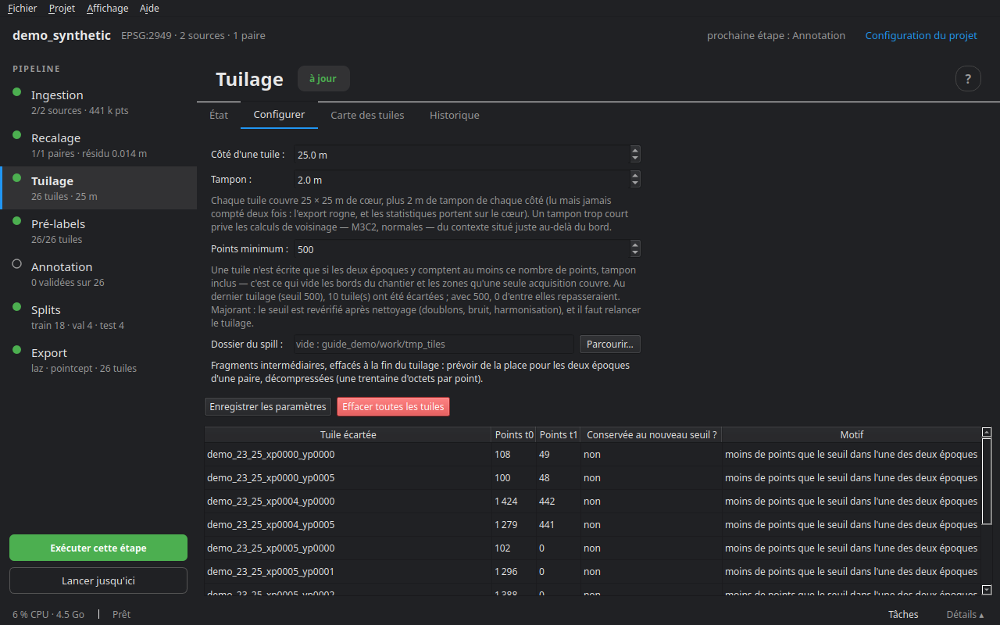
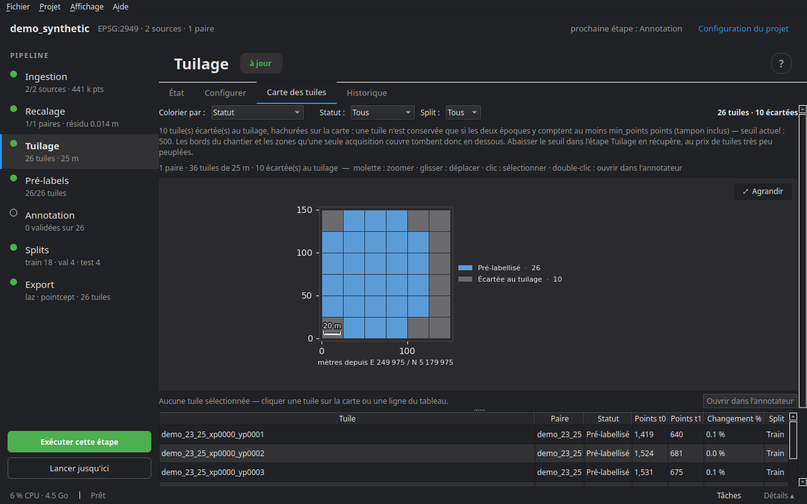

# Découpage en tuiles

Le tuilage découpe chaque paire sur une grille commune aux deux époques : une tuile contient les points de t0 et de t1 sur la même emprise, t1 déjà ramené par le recalage. C'est l'unité de tout ce qui suit — pré-label, annotation, répartition, export.

## Cœur et tampon

Chaque tuile a un **cœur** de `size × size` mètres, qui n'appartient qu'à elle, et un **tampon** de `overlap` mètres de chaque côté, pris sur ses voisines. Le tampon est lu pour que les calculs de voisinage (normales, cylindres de M3C2, rayons) voient le contexte au bord, mais il n'est jamais compté deux fois : l'export le rogne, les statistiques portent sur le cœur, et la répartition en tient compte pour éviter les fuites entre train et test (voir [Splits](09_splits.md)).

Chaque tuile est nettoyée au passage, de la même façon pour les deux époques : les doublons à moins de `dedup_eps` (1 mm) sont retirés.

## Le seuil de points

Une tuile n'est écrite que si **les deux** époques y comptent au moins `min_points` points, tampon inclus. C'est ce qui vide les bords du chantier et les zones qu'une seule époque couvre. Les tuiles écartées restent listées — sur la carte et dans `skipped.json` — avec leur motif et leur nombre de points ; le tableau de l'onglet Configurer dit lesquelles repasseraient avec un autre seuil.

## L'onglet Configurer



| Réglage | Rôle |
|---|---|
| Côté d'une tuile | ce qu'on voit d'un coup en annotant ; 25 à 50 m pour un relevé urbain |
| Tampon | ce que les calculs de voisinage trouvent au bord ; au moins le rayon de mesure du pré-label |
| Points minimum | le seuil ci-dessus |
| Dossier du spill | où écrire les fragments intermédiaires, effacés à la fin : prévoir une trentaine d'octets par point pour les deux époques d'une paire. Un SSD accélère nettement quand le projet est sur un disque dur |

**Enregistrer les paramètres** les écrit dans `project.yaml` ; ils ne changent rien aux tuiles déjà écrites. **Exécuter cette étape** ouvre la sélection des paires à tuiler (**Seulement les nouvelles**, ou toutes), le nombre de **tuiles en parallèle** et le **moteur du spill** (Rust s'il est installé). Une estimation du nombre de cases de grille s'affiche avant de lancer.

**Effacer toutes les tuiles** supprime les tuiles de toutes les paires, annotations comprises, après confirmation.

### Retuiler un projet annoté

Chaque point reçoit à l'ingestion un identifiant stable. Les labels posés à la main le suivent : changer la taille, le tampon ou l'origine de la grille puis retuiler les rend aux mêmes points, dans les nouvelles tuiles.

## L'onglet Carte des tuiles



La grille vue de dessus, une case par tuile, et un tableau à côté (tuile, paire, statut, split, taux de changement).

- **Colorier par** : statut (tuilé, pré-labellisé, en cours, validé, rejeté), split, taux de changement (part des points du cœur marqués changés), incertitude (1 − confiance moyenne) ou nombre de points.
- **Filtres** : paire, statut, split.
- Une tuile survolée donne son statut, son split, ses points en t0 et t1, son changement et son incertitude ; une tuile écartée, son motif.
- **Double-clic**, ou **Ouvrir dans l'annotateur** : ouvre la tuile dans l'éditeur.

## Sur le disque

```
tiles/<paire>/
  tiles.geojson              # l'emprise de chaque tuile
  skipped.json               # les tuiles écartées et pourquoi
  <tuile>/
    meta.json                # emprise, cœur, comptes, état
    t0.laz, t1.laz           # la géométrie et les attributs
    labels/<couche>/         # les étiquettes, par couche
      t0_semantic.npz, t0_change.npz, t1_semantic.npz, t1_change.npz
```

## En ligne de commande

```bash
cdforge tile mon_projet
cdforge status mon_projet     # l'avancement des tuiles par paire
```

Étape suivante : [Pré-labellisation](06_prelabel.md).
