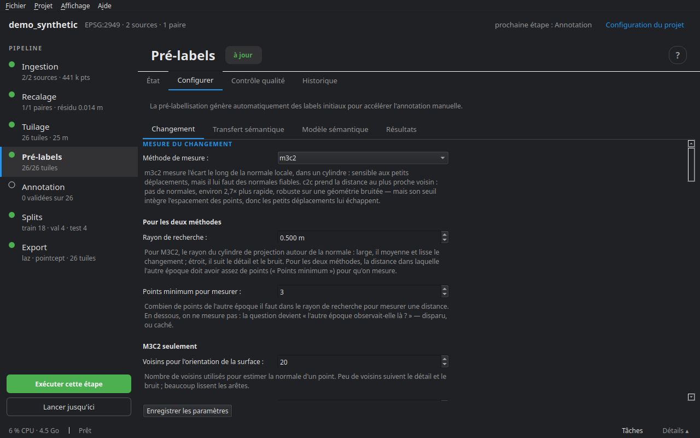

# Pré-labellisation

Le pré-label propose, pour chaque point de chaque tuile, une classe de changement et une classe sémantique, avec une **confiance**. Il ne remplace pas l'annotation : il la prépare. Les labels importés d'une vérité terrain et ceux posés à la main ne sont **jamais** écrasés ; les labels automatiques gardent leur provenance, et l'annotateur sait toujours ce qui reste à vérifier.

Le détail complet de la décision de changement, réglage par réglage, est dans **Aide ▸ [Comment le pré-label décide d'un changement](../changement_et_rayons.md)**.

## Le changement

Chaque époque est étiquetée à son tour contre l'autre, **avec exactement le même code** : les points de t0 sortent *unchanged*, *removed* ou *unobserved* ; ceux de t1, *unchanged*, *added* ou *unobserved*. Pour un point de l'époque A, face à l'autre époque B :

1. **Mesurer** — B a-t-il au moins `min_pts` points en face, dans le rayon de recherche ?
2. Si oui, **la distance décide** : au-dessus du seuil, le point a changé (*added* ou *removed*) ; en dessous, il est *unchanged*.
3. Si non, la question devient **« B regardait-il cet endroit ? »** — oui : l'objet a disparu (ou est apparu) ; non : *unobserved*, un angle mort où rien n'est décidable.
4. **Nettoyage** — un amas de points changés plus petit que `min_cluster` est remis à *unchanged* : un vrai changement a une étendue.

*transient* n'est jamais décidé ici : un véhicule garé à t0 et parti à t1 sort *removed*. C'est l'annotateur qui propose de requalifier en *transient* les changements portés par une classe temporaire (voir [Annotation](08_annotation.md)).

### Deux méthodes de mesure

**M3C2** (par défaut) mesure l'écart le long de la normale locale, dans un cylindre, et calcule un **seuil de détection par point** (LoD95) à partir de la rugosité des deux nuages et de l'erreur de recalage. Sensible aux petits déplacements, il lui faut des normales fiables. La règle **même surface** ne garde, dans le cylindre d'un point plan, que les voisins orientés comme lui : le cylindre d'un point de sol n'attrape plus le mur voisin.

**C2C** prend la distance au plus proche voisin : pas de normales, environ 2,7 fois plus rapide, robuste sur une géométrie bruitée ou éparse. Son seuil, en automatique, vaut 1,96 × l'erreur de recalage **plus l'espacement des points** — deux relevés d'une même surface ne tombent jamais pile l'un sur l'autre — donc les petits déplacements lui échappent. On peut aussi le **fixer à la main**.

### « B regardait-il cet endroit ? »

- **La couverture**, toujours calculée : B a-t-il un point dans la même case au sol, un point proche (`obs_radius`), des points sur assez de côtés (`obs_quadrants`) ? Chaque portion se coupe séparément. Elle confond une occultation qui laisse des points à proximité avec une disparition.
- **Les rayons**, quand la source B a une **trajectoire** : la ligne du capteur au point traverse-t-elle du vide (l'endroit était vu, l'objet a disparu) ou un obstacle (il était caché) ? Ils tranchent vraiment, mais seulement là où un point de vue existe ; ailleurs, la couverture répond.

## La sémantique

Plusieurs sources, qui se complètent, sans jamais écraser un label importé ou manuel :

- **les classes de la source**, lues à l'ingestion par son schéma ;
- **le modèle géométrique intégré** : la forme locale du nuage — hauteur au-dessus du sol, linéarité, planarité, dispersion, verticalité — distingue sol, bâti, végétation, poteaux ; aucune dépendance ;
- **le transfert entre époques** : un point inchangé et sans classe reçoit le vote majoritaire de ses `transfer_k` plus proches voisins étiquetés dans l'autre époque (confiance = part du vote) ; un point changé n'hérite jamais ;
- **un modèle d'apprentissage profond**, lancé depuis l'onglet Modèle sémantique ou importé (voir [Modèles sémantiques](07_ia.md)).

Le **sol par simulation de tissu** (CSF) se règle dans l'annotateur, sur une tuile qu'on regarde, puis s'applique aux autres.

## L'onglet Configurer



Quatre sous-onglets.

**Changement**

- *Mesure du changement* : la méthode, puis trois groupes — **pour les deux méthodes** (rayon de recherche, points minimum pour mesurer), **M3C2 seulement** (voisins pour l'orientation de la surface, profondeur de recherche, points au plus par cylindre, même surface : angle et planéité), **C2C seulement** (seuil de changement, auto ou fixé). Ce qui ne sert pas à la méthode choisie est grisé.
- *Ce que l'autre époque observait* : les trois portions de la couverture, puis les rayons — quand en lancer, taille des voxels, points de vue essayés et leur écart, portée, ce qu'on ignore autour du capteur et autour du point, ce que les rayons ont le droit de changer.
- *Nettoyage* : plus petit changement gardé, distance de regroupement.
- *Incertitude du recalage* : la NMAD du recalage (auto) ou une valeur.
- *Exécution* : le moteur des voisinages (Rust s'il est installé) et le nombre de tuiles en parallèle — des choix de cette exécution, pas des réglages du projet.

Sous chaque champ, ce qu'il fait. **Revenir aux valeurs par défaut** remet l'onglet à zéro sans rien écrire ; **Enregistrer les paramètres** écrit `project.yaml`.

**Transfert sémantique** — l'activer, et le nombre de voisins du vote.

**Modèle sémantique** — le modèle géométrique (activer, voisinage, sol, seuils des objets) et le catalogue des modèles d'apprentissage profond (voir [Modèles sémantiques](07_ia.md)).

**Résultats** — ce qu'a produit le dernier pré-label : les labels de changement de t0 et t1, la part décidée par les rayons et par la couverture, et les points où le rayon a conclu autrement que la couverture.

## L'onglet Contrôle qualité

**Vérifier la qualité** relit les rapports de pré-label et liste, par tuile, ce qui mérite un regard : beaucoup d'amas isolés remis à *unchanged*, une forte proportion *unobserved* (un bord de couverture ?), une confiance de changement faible. **Ouvrir** mène à la tuile. **Compter les classes** donne la distribution des classes sémantiques sur le cœur des tuiles.

## Voir une décision

Dans l'annotateur, la touche **R** sur un point rejoue sa décision, étape par étape, avec les rayons dessinés. C'est le moyen le plus direct de comprendre un label qui surprend, et de savoir quel réglage le changerait.

## En ligne de commande

```bash
cdforge prelabel mon_projet
cdforge import-predictions DOSSIER mon_projet   # <tuile>/<époque>_semantic.npy, faites ailleurs
```

Étape suivante : [Modèles sémantiques](07_ia.md), ou directement [Annotation](08_annotation.md).
