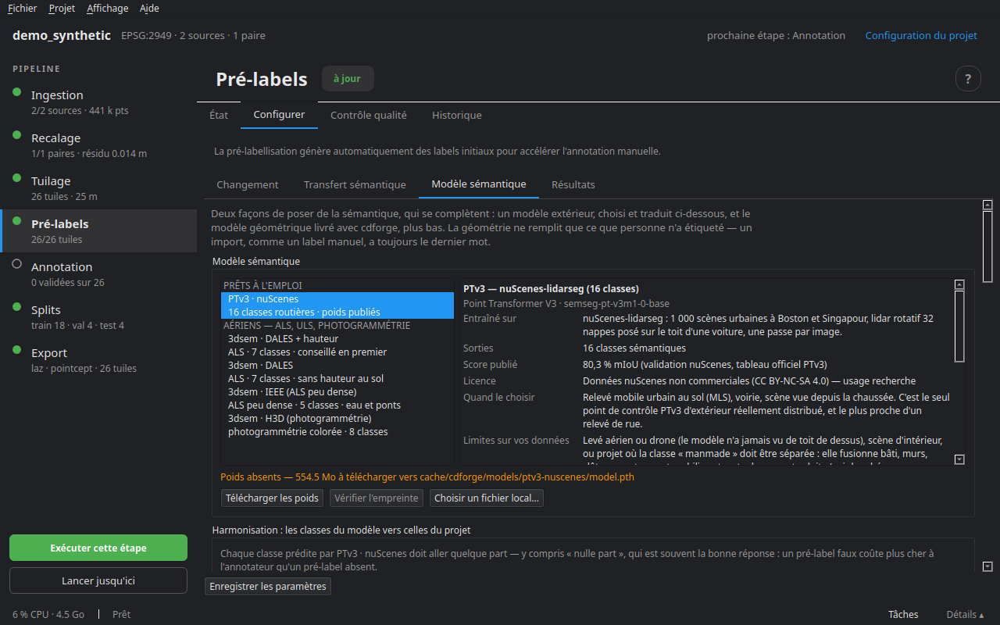

# Modèles sémantiques

Un modèle d'apprentissage profond peut poser une première sémantique sur des tuiles qui n'en ont aucune. cdforge ne dépend pas de torch : le modèle tourne dans un autre interpréteur — le **module IA** prêt à l'emploi, ou un environnement que vous avez déjà — et ses prédictions reviennent comme des pré-labels, avec leur provenance. Tout se passe dans l'étape **Pré-labels ▸ Configurer ▸ Modèle sémantique**.

## Le catalogue



Le catalogue ne liste que des modèles que cdforge sait **réellement lancer**, avec des poids publiés dont il connaît la taille et l'empreinte.

| Modèle | Groupe | Pour quelles données |
|---|---|---|
| **LitePT-S · nuScenes** | prêt à l'emploi | lidar mobile ou embarqué, scène routière : les 16 classes de PTv3 nuScenes, avec un réseau 3,6 fois plus petit |
| **LitePT-S · Waymo** | prêt à l'emploi | la même scène en 22 classes, les plus fines : tronc et feuillage, panneau et mât, bordure et trottoir |
| **PTv3 · nuScenes** | prêt à l'emploi | lidar mobile ou embarqué, scène routière : 16 classes — surface roulable, trottoir, terrain, végétation, huit sortes de véhicules, piétons, cônes, barrières, et *manmade* pour tout le bâti |
| **3dsem · DALES** (avec hauteur au sol) | aérien | lidar aéroporté : 7 classes — conseillé en premier |
| **3dsem · DALES** | aérien | le même sans la hauteur au-dessus du sol |
| **3dsem · IEEE** | aérien | aéroporté peu dense : 5 classes, dont l'eau et les ponts |
| **3dsem · H3D** | aérien | photogrammétrie colorée : 8 classes |
| **PTv3 · ScanNet**, **LitePT-S · ScanNet** | intérieur | pièces relevées avec la couleur : 20 classes (murs, sol, mobilier) |
| **PTv3 · ScanNet200** | intérieur | les mêmes pièces en 200 classes d'objets |
| **PTv3 · S3DIS** | intérieur | bâtiment tertiaire : 13 classes, la structure plus que le mobilier |
| **LitePT · Structured3D** (S, B, L) | intérieur | logements : 25 classes, plafond et structure compris |

Pour chaque modèle, la fiche dit sur quoi il a été entraîné, ce qu'il sort, son score publié, ses limites sur vos données et quand le choisir. Un modèle entraîné ailleurs se charge avec **Choisir un fichier local…** : son chemin remplace le téléchargement.

**Télécharger les poids** les place dans le cache de cdforge ; **Vérifier l'empreinte** les compare au SHA-256 attendu. Pour LitePT, le premier téléchargement apporte aussi le code du réseau (son propre dépôt, une version épinglée et vérifiée). Les modèles 3dsem s'installent avec leur propre environnement (**Installer avec 3dsem**).

### Les modèles d'intérieur

Ils ont appris sur des pièces, avec la **couleur** et les **normales** par point, et prédisent « mur », « sol », « lit » ou « rideau de douche ». Aucune correspondance n'est fournie : c'est au tableau de dire ce que vous en gardez. La case **Afficher aussi les modèles d'intérieur** les retire de la liste.

cdforge prépare leur entrée sur les deux époques d'une tuile à la fois, pour qu'elles soient traitées pareil : un même repère (centre de l'emprise commune, point le plus bas à zéro), des normales estimées sur les points que garde la grille et tournées vers un même point de vue, et la couleur seulement si **les deux** époques en ont — sinon un gris neutre pour les deux, pour que le réseau n'y voie pas un changement de matière.

### Les poids PTv3 publiés

Ils ont été entraînés avant une correction de structure de Pointcept (mars 2024) : chargés tels quels dans un Pointcept récent, ils se chargent sans erreur et prédisent faux. cdforge rend au réseau la structure avec laquelle ils ont appris — sans cela, 46 % d'exactitude au lieu de 97 % sur une pièce ScanNet de démonstration. Des prédictions PTv3 faites avec cdforge avant la version qui porte cette correction sont à refaire.

## L'harmonisation : des classes du modèle à celles du projet

Chaque classe que prédit le modèle doit aller quelque part — y compris **nulle part**, souvent la bonne réponse : un pré-label faux coûte plus cher à l'annotateur qu'un pré-label absent.

Le tableau donne, pour chaque classe du modèle, la classe du projet où elle se range. Trois **préréglages** :

- **Correspondance fournie avec cdforge** — relevée classe par classe dans la documentation du jeu d'entraînement ;
- **Garder les classes du modèle** — ajoute au projet celles qui lui manquent (`car` sous `vehicle`, par exemple), pour garder la finesse du modèle ;
- **Tout laisser non étiqueté** — pour partir de zéro.

**Classes du projet…** ouvre l'éditeur de classes, pour en ajouter une là où elle manque. **Enregistrer la correspondance dans le projet** écrit le tableau dans `schemes/` : un fichier comme un autre, relisible et versionnable. C'est elle que l'import de ce modèle prend ensuite d'office.

## Obtenir les prédictions

### Lancer l'inférence

- **Interpréteur** : le module IA s'il est installé, ou un Python avec torch que **Détecter** trouve en essayant vraiment chacun de ceux de la machine.
- **Canaux d'entrée** : ce que le modèle reçoit (l'intensité, par exemple), parmi ce que vos tuiles ont.
- **Calcul** : GPU (CUDA) ou processeur — qui fonctionne, mais compte plusieurs minutes par tuile là où un GPU met quelques secondes.
- **Grille de voxels** : zéro garde celle de l'entraînement, et c'est le bon choix.
- **Tuiles par lot**, **lots en parallèle** : pour remplir le GPU.
- **Confiance minimale** et **points sous le seuil** : laissés non étiquetés (par défaut), ou étiquetés et marqués incertains.
- **Avant d'écrire** : ajouter aux pré-labels existants (par défaut), ou effacer d'abord les pré-labels automatiques.

**Préparer les tuiles et lancer l'inférence** : l'avancement passe dans le panneau des tâches. Quand elle a fini, ses prédictions sont rangées d'elles-mêmes dans les tuiles, avec les réglages ci-dessus. Si elle échoue, rien n'est rangé.

**Importer les prédictions** range de nouveau une inférence déjà faite, sans la relancer : pour essayer un autre seuil, une autre correspondance, ou « effacer d'abord ». Champ « Prédictions » laissé vide, il reprend le dossier où l'inférence du projet les a écrites.

Une tuile ouverte dans l'annotateur pendant l'import est relue d'elle-même. Les gestes déjà faits sont gardés, et l'annulation repart de là.

### Importer des prédictions faites ailleurs

Un dossier `<tuile>/<époque>_semantic.npy` (un identifiant de classe par point, dans l'ordre des points de la tuile), le nom du modèle et la **correspondance des classes du modèle**, qui suit le modèle choisi : celle enregistrée dans le projet pour lui, sinon celle fournie. Pour un modèle du catalogue, l'import refuse de partir sans correspondance, ou avec une correspondance écrite pour un autre modèle : ses numéros deviendraient des classes du projet sans que rien ne le signale. « — aucune — » sert aux prédictions d'un modèle qui sort déjà les classes du projet, sous son propre nom. Même seuil de confiance, même choix avant d'écrire. En ligne de commande : `cdforge import-predictions DOSSIER mon_projet`.

Dans les deux cas, le modèle, l'empreinte des poids, la correspondance et le seuil sont écrits avec chaque tuile. Les labels manuels et la vérité terrain ne sont jamais touchés.

L'import fait aussi ce que le pré-label tire des classes : le modèle géométrique remplit ce que « effacer d'abord » a vidé, et le transfert entre époques, s'il est allumé, propage les nouvelles classes. Sur une tuile déjà pré-labellisée, il n'y a donc rien à relancer : la détection de changement ne lit aucune classe. Une tuile pas encore pré-labellisée attend l'étape Pré-labellisation, et le résultat de l'import le signale.

## Le module IA

**Aide ▸ Module IA…** — un Python autonome qui porte torch, CUDA, Pointcept et SNAP, compilés d'avance : environ 3 Go à télécharger, une fois. Il fait tourner **PTv3** et **LitePT** pour le pré-label et **SNAP** pour l'annotation assistée (voir [Annotation](08_annotation.md)), sur une carte NVIDIA. Le reste de cdforge fonctionne sans.

- **Installer** — télécharge et installe ; une installation interrompue reprend là où elle s'est arrêtée.
- **Depuis un dossier…** — depuis un dossier qui contient `module.json` et ses morceaux (clé USB, téléchargement fait ailleurs).
- **Vérifier** — relance l'essai sur la carte : un vrai calcul par pièce.
- **Désinstaller**.
- **Mettre à jour vers…** — quand un module plus récent est publié : la fenêtre propose le plus récent que cette version de cdforge sait employer et que la carte fait tourner. L'ancien (9 Go) n'est retiré qu'une fois le nouveau essayé avec succès.

Tant qu'il n'est pas installé, un bandeau le propose dans l'espace de travail ; **Ne plus proposer** le fait taire. Un module trop ancien pour cette version (le 1.0 ne lit pas les tuiles LAZ : PTv3 et LitePT y échouent, SNAP y tourne) est signalé de la même façon, avec **Mettre à jour le module IA…**.

Installé, le module est comparé aux modules publiés en même temps que l'application cherche ses nouvelles versions : au démarrage, puis toutes les 3 heures, et **Rechercher les mises à jour automatiquement** coupe les deux. Un module plus récent s'annonce dans le même bandeau, avec **Mettre à jour le module IA…** ; **Plus tard** le tait jusqu'au prochain lancement, **Ignorer cette version** ne le propose plus. **Aide ▸ Rechercher des mises à jour…** répond aussi pour le module. Rien ne se télécharge sans un clic.

## En ligne de commande

```bash
cdforge models                               # le catalogue
cdforge fetch-weights ptv3-nuscenes          # télécharger et vérifier des poids
cdforge stage-inference ptv3-nuscenes mon_projet   # préparer les tuiles, afficher la commande
```

Étape suivante : [Annotation](08_annotation.md).
