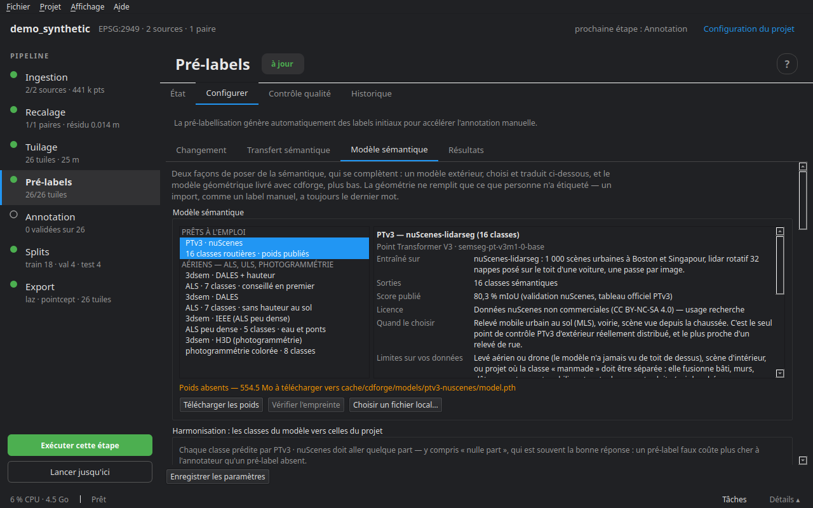

# Modèles sémantiques

Un modèle d'apprentissage profond peut poser une première sémantique sur des tuiles qui n'en ont aucune. cdforge ne dépend pas de torch : le modèle tourne dans un autre interpréteur — le **module IA** prêt à l'emploi, ou un environnement que vous avez déjà — et ses prédictions reviennent comme des pré-labels, avec leur provenance. Tout se passe dans l'étape **Pré-labels ▸ Configurer ▸ Modèle sémantique**.

## Le catalogue



Le catalogue ne liste que des modèles que cdforge sait **réellement lancer**, avec des poids publiés dont il connaît la taille et l'empreinte.

| Modèle | Groupe | Pour quelles données |
|---|---|---|
| **PTv3 · nuScenes** | prêt à l'emploi | lidar mobile ou embarqué, scène routière : 16 classes — surface roulable, trottoir, terrain, végétation, huit sortes de véhicules, piétons, cônes, barrières, et *manmade* pour tout le bâti |
| **3dsem · DALES** (avec hauteur au sol) | aérien | lidar aéroporté : 7 classes — conseillé en premier |
| **3dsem · DALES** | aérien | le même sans la hauteur au-dessus du sol |
| **3dsem · IEEE** | aérien | aéroporté peu dense : 5 classes, dont l'eau et les ponts |
| **3dsem · H3D** | aérien | photogrammétrie colorée : 8 classes |

Pour chaque modèle, la fiche dit sur quoi il a été entraîné, ce qu'il sort, son score publié, ses limites sur vos données et quand le choisir. Un modèle entraîné ailleurs se charge avec **Choisir un fichier local…** : son chemin remplace le téléchargement.

**Télécharger les poids** les place dans le cache de cdforge ; **Vérifier l'empreinte** les compare au SHA-256 attendu. Les modèles 3dsem s'installent avec leur propre environnement (**Installer avec 3dsem**).

## L'harmonisation : des classes du modèle à celles du projet

Chaque classe que prédit le modèle doit aller quelque part — y compris **nulle part**, souvent la bonne réponse : un pré-label faux coûte plus cher à l'annotateur qu'un pré-label absent.

Le tableau donne, pour chaque classe du modèle, la classe du projet où elle se range. Trois **préréglages** :

- **Traduction fournie avec cdforge** — relevée classe par classe dans la documentation du jeu d'entraînement ;
- **Garder les classes du modèle** — ajoute au projet celles qui lui manquent (`car` sous `vehicle`, par exemple), pour garder la finesse du modèle ;
- **Tout laisser non étiqueté** — pour partir de zéro.

**Classes du projet…** ouvre l'éditeur de classes, pour en ajouter une là où elle manque. **Enregistrer le schéma dans le projet** écrit la traduction dans `schemes/` : un fichier comme un autre, relisible et versionnable.

## Obtenir les prédictions

### Lancer l'inférence

- **Interpréteur** : le module IA s'il est installé, ou un Python avec torch que **Détecter** trouve en essayant vraiment chacun de ceux de la machine.
- **Canaux d'entrée** : ce que le modèle reçoit (l'intensité, par exemple), parmi ce que vos tuiles ont.
- **Calcul** : GPU (CUDA) ou processeur — qui fonctionne, mais compte plusieurs minutes par tuile là où un GPU met quelques secondes.
- **Grille de voxels** : zéro garde celle de l'entraînement, et c'est le bon choix.
- **Tuiles par lot**, **lots en parallèle** : pour remplir le GPU.
- **Confiance minimale** et **points sous le seuil** : laissés non étiquetés (par défaut), ou étiquetés et marqués incertains.
- **Avant d'écrire** : ajouter aux pré-labels existants (par défaut), ou effacer d'abord les pré-labels automatiques.

**Préparer les tuiles et lancer l'inférence** : l'avancement passe dans le panneau des tâches.

### Importer des prédictions faites ailleurs

Un dossier `<tuile>/<époque>_semantic.npy` (un identifiant de classe par point, dans l'ordre des points de la tuile), le nom du modèle et son schéma de classes. Même seuil de confiance, même choix avant d'écrire. En ligne de commande : `cdforge import-predictions DOSSIER mon_projet`.

Dans les deux cas, le modèle, l'empreinte des poids, le schéma et le seuil sont écrits avec chaque tuile. Les labels manuels et la vérité terrain ne sont jamais touchés.

## Le module IA

**Aide ▸ Module IA…** — un Python autonome qui porte torch, CUDA, Pointcept et SNAP, compilés d'avance : environ 3 Go à télécharger, une fois. Il fait tourner **PTv3** pour le pré-label et **SNAP** pour l'annotation assistée (voir [Annotation](08_annotation.md)), sur une carte NVIDIA. Le reste de cdforge fonctionne sans.

- **Installer** — télécharge et installe ; une installation interrompue reprend là où elle s'est arrêtée.
- **Depuis un dossier…** — depuis un dossier qui contient `module.json` et ses morceaux (clé USB, téléchargement fait ailleurs).
- **Vérifier** — relance l'essai sur la carte : un vrai calcul par pièce.
- **Désinstaller**.

Tant qu'il n'est pas installé, un bandeau le propose dans l'espace de travail ; **Ne plus proposer** le fait taire.

## En ligne de commande

```bash
cdforge models                               # le catalogue
cdforge fetch-weights ptv3-nuscenes          # télécharger et vérifier des poids
cdforge stage-inference ptv3-nuscenes mon_projet   # préparer les tuiles, afficher la commande
```

Étape suivante : [Annotation](08_annotation.md).
