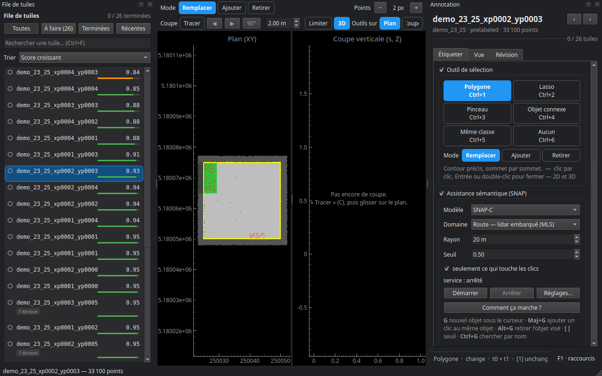

# Annotation

L'annotateur ouvre une tuile — ses deux époques — pour corriger les pré-labels et compléter ce qui manque, point par point. On l'ouvre avec **Ouvrir l'éditeur d'annotation**, sous la colonne quand l'étape Annotation est sélectionnée ou dans son onglet **Éditeur**, par un double-clic sur la carte des tuiles, ou avec `cdforge gui mon_projet`.

Chaque modification est enregistrée tuile par tuile au fil de l'édition : un arrêt brutal ne perd que le geste en cours. Chaque action est aussi écrite dans le journal de la tuile (qui, quand, quoi, combien de points), et chaque label posé à la main prend la provenance *manuel*.

## La fenêtre

- **File de tuiles**, à gauche : toutes, à faire, terminées, récentes ; une recherche (Ctrl+F) ; un tri (par score, pour commencer par les tuiles les plus douteuses).
- **Les vues**, au centre : la vue **3D**, le **plan** (XY) et la **coupe verticale**. Les mêmes outils de sélection marchent dans les trois. En 3D, Ctrl + glisser fait tourner la vue quel que soit l'outil ; la molette zoome ; le bouton du milieu déplace.
- **Le panneau**, à droite, en trois onglets : **Étiqueter**, **Vue**, **Révision**.

## Étiqueter

**Outil de sélection** — polygone (Ctrl+1), lasso (Ctrl+2), pinceau (Ctrl+3), objet connexe (Ctrl+4), même classe (Ctrl+5), aucun — déplacer la vue (Ctrl+6). Le **mode** dit ce que fait un geste : **Remplacer**, **Ajouter** ou **Retirer** la sélection ; **E** bascule en retrait et revient.

**Cible de l'édition** — la **couche** (sémantique ou changement, **L** pour basculer) et l'**époque**.

**Classes** — la liste de la couche active ; **1** à **9** et **0** choisissent une classe, **A** l'applique à la sélection. **Chiffres 1–9, 0** règle ce que fait un chiffre : **Choisir, puis A** (par défaut) ou **Appliquer**, qui applique la classe dès le chiffre ; A applique dans les deux cas.

**Sur la sélection** — appliquer la classe (A), sélectionner toute la classe (S), élargir ou rétrécir (+ / −), propager à l'autre époque (T), changement de l'objet (K), valider auto → manuel (V), incertain (I), non étiqueté (U), écarter des points du jeu de données (Suppr) et les restaurer (Maj+Suppr), vider la sélection (Échap), annuler et rétablir.

Un point **écarté** (bruit, oiseau, point fantôme) n'est pas une classe de plus : il reste sur le disque, hors du jeu de données, et se restaure.

### Annoter les deux dates

Une tuile a deux époques, et un objet qui a changé se lit sur les deux. **T** reporte la sélection et sa classe sur les points correspondants de l'autre date ; **K** montre le changement de l'objet sélectionné ; **M** sélectionne le miroir sur l'autre date. Le détail : **Aide ▸ [Annoter les deux dates](../deux_dates.md)**.

### L'assistance SNAP

Avec le module IA (voir [Modèles sémantiques](07_ia.md#le-module-ia)), **Démarrer** lance le service SNAP. Ensuite, dans la vue 3D :

- **G** segmente l'objet sous le curseur et propose sa classe ;
- **Maj+G** ajoute un clic au même objet, pour l'affiner ;
- **Alt+G** retire du masque l'objet sous le curseur ;
- **Ctrl+G** cherche une catégorie par son nom (« pole », « vegetation »…) ;
- **[** et **]** élargissent ou resserrent le masque.

Huit modèles, pour trois domaines — extérieur, intérieur (avec la couleur), aérien. Le détail : **Aide ▸ [Assistance sémantique SNAP](../assistance_snap.md)**.

### Le sol par simulation de tissu

**Classer le sol — CSF…** (Ctrl+Maj+G) ouvre une fenêtre où un drap tombe sur une coupe du nuage : on y voit l'effet de chaque réglage, puis on l'applique à la tuile. Le réglage retenu sert ensuite au pré-label des autres tuiles.

**P** fait croître une région depuis le point sous le curseur.

## Vue

- **Époques et couleurs** — t0, t1 ou les deux ; Espace bascule, Ctrl+B fait clignoter t0 ↔ t1. Colorer par changement, sémantique (fine ou en grandes classes), RGB du relevé, intensité, hauteur, distance t0 ↔ t1, provenance des labels, points incertains, ou points requalifiés par les rayons.
- **Classes affichées** — **H** masque ou réaffiche la classe active, **Maj+H** réaffiche tout.
- **Clipping** — bornes basse et haute, par exemple pour voir sous les arbres.
- **Capteur et rayons** — la trajectoire du capteur, et les rayons rejoués par **R**.
- **Points** — taille (Ctrl++ / Ctrl+−), détail, réinitialiser la caméra.

La **coupe** se trace avec **C** dans le plan ; **,** et **.** la décalent d'une largeur.

## Révision

- **Progression de la tuile** — ce qui est décidé, ce qui reste.
- **À vérifier** — sélectionner les points auto-remplis, non étiquetés, incertains, ou requalifiés par les rayons.
- **Corrections d'ensemble** :
  - **Changements temporaires…** — requalifie en *transient* les points ajoutés ou retirés dont la classe est temporaire (véhicule, personne…) ; c'est ici, et non au pré-label, que cela se décide ;
  - **Remplacer une classe…** — sur toute la tuile (pour tout le projet : **Projet ▸ Classes du projet ▸ Fusionner dans…**) ;
  - **Transférer le tampon aux voisines…** — ce qui a été étiqueté à la main dans le tampon rejoint la tuile où ces points sont au cœur, puisque l'export ne garde que les cœurs.
- **Afficher seulement** — des filtres : non étiquetés, labels automatiques, incertains, classe active, cœur seulement, changements mesurés ; **Réinitialiser les filtres**.
- **Note sur la tuile**.
- **Fin de tuile** — enregistrer (Ctrl+S), marquer la tuile terminée, **terminé et tuile suivante** (Ctrl+D), rouvrir, rejeter.

Une tuile passe par les statuts *tuilée → pré-labellisée → en cours → terminée* (ou *rejetée*). Le pré-label ne retouche jamais une tuile en cours ou terminée.

## Comprendre un label : la touche R

Sur un point de la vue 3D, **R** rejoue la décision de changement : la mesure, le seuil, la couverture, les rayons du capteur dessinés dans la 3D et le plan, et l'étape qui a tranché.

## Les raccourcis

**F1** dans l'annotateur affiche la table complète, lue dans le programme lui-même.

| Touche | Action |
|---|---|
| 1…9, 0 | choisir la classe |
| A | appliquer la classe |
| S | sélectionner toute la classe |
| V | valider auto → manuel |
| U | non étiqueté |
| I | marquer incertain |
| T | propager à l'autre époque |
| K | changement de l'objet |
| M | miroir sur l'autre date |
| + / − | élargir / rétrécir la sélection |
| Échap | vider la sélection |
| E | mode retrait |
| Suppr / Maj+Suppr | écarter / restaurer les points |
| Ctrl+1…6 | outil de sélection |
| L | changer de couche |
| Espace / Ctrl+B | basculer d'époque / clignotement |
| H / Maj+H | masquer la classe active / tout réafficher |
| C | tracer la coupe |
| , / . | décaler la coupe |
| P | croissance de région |
| R | expliquer la décision de changement |
| G, Maj+G, Alt+G, Ctrl+G | assistance SNAP |
| [ / ] | seuil SNAP |
| Ctrl+Maj+G | sol par simulation de tissu |
| Ctrl++ / Ctrl+− | taille des points |
| Ctrl+Z / Ctrl+Y | annuler / rétablir |
| Ctrl+S | enregistrer |
| Ctrl+D | terminer la tuile et ouvrir la suivante |
| N / B | tuile suivante / précédente |
| Ctrl+F | rechercher une tuile |
| Entrée | fermer le polygone |
| F1 | l'aide |

Étape suivante : [Splits](09_splits.md).
