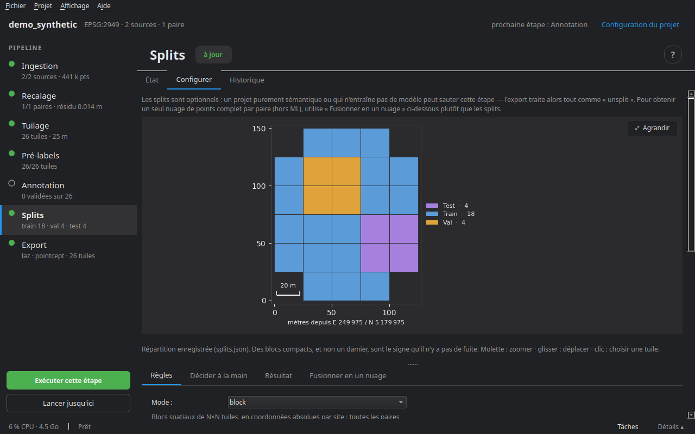

# Splits

Pour entraîner et évaluer un modèle, les tuiles se répartissent en **train**, **validation** et **test**. La difficulté est la **fuite** : deux tuiles voisines partagent leur tampon, et plusieurs paires peuvent couvrir le même sol. Une répartition tuile par tuile met alors les mêmes points des deux côtés, et le score de test mesure la mémoire du modèle, pas sa capacité à généraliser.

Cette étape est facultative : un projet purement sémantique, ou qui n'entraîne pas de modèle, peut la sauter ; l'export traite alors tout comme *unsplit*.

## Les modes

| Mode | Ce qu'il fait |
|---|---|
| **block** (défaut) | des blocs spatiaux de N × N tuiles, en coordonnées absolues par site : toutes les paires qui couvrent un même endroit tombent dans le même split |
| **site** | des sites entiers partent en validation ou en test — le test de généralisation le plus exigeant, et le seul honnête si les sites diffèrent |
| **random** | un tirage par tuile : simple, mais le même point peut se retrouver en train et en test |

## La garde contre les fuites

| Garde | Ce qu'elle fait |
|---|---|
| **trim** (défaut) | les points de tampon qui tombent dans le cœur d'une tuile d'un autre split sont rognés à l'export : aucun point partagé, aucune tuile perdue |
| **exclude** | toute tuile qui touche un autre split est retirée du jeu : plus simple à expliquer, mais on perd des tuiles entières |
| **none** | aucune garde |

La garde ne s'applique pas en mode *random* : elle ne pourrait pas rattraper un tirage qui mélange déjà les tuiles voisines.

## L'onglet Configurer



Une carte des tuiles colorées par split, à côté de quatre onglets.

**Règles** — le mode ; la **part** de chaque split (normalisée si leur somme ne fait pas 1 ; elle porte sur le nombre de tuiles, pas de points) ; les **tuiles par bloc** (mode *block*) ; la **garde** ; la **graine**, et **Autre tirage** pour en essayer une autre quand la répartition tombe mal ; les **sites réservés** à la validation et au test (mode *site*).

**Aperçu (n'écrit rien)** montre la répartition sur la carte ; **Appliquer et générer** l'enregistre dans `splits.json`. Des blocs compacts, et non un damier, sont le signe qu'il n'y a pas de fuite.

**Décider à la main** — cliquer une tuile sur la carte, puis lui choisir un split, l'**écarter**, ou la **rendre à l'automatique** ; **Appliquer au bloc entier** fait de même pour les tuiles de son bloc. Les décisions sont écrites dans `project.yaml` et réappliquées à chaque génération — changer de graine ou de parts ne les défait pas — et la garde les protège comme les autres.

**Résultat** — le nombre de tuiles par split, obtenu et visé, les décisions manuelles, et les tuiles dont le tampon sera rogné.

**Fusionner en un nuage** — réassemble toutes les tuiles d'une paire en un nuage t0 et un nuage t1 complets (les cœurs seulement, sans doublons de tampon), avec les labels actuels. Indépendant des splits : pour utiliser le résultat hors apprentissage automatique (`cdforge merge` en ligne de commande).

## En ligne de commande

```bash
cdforge split mon_projet
```

Étape suivante : [Export et évaluation](10_export.md).
