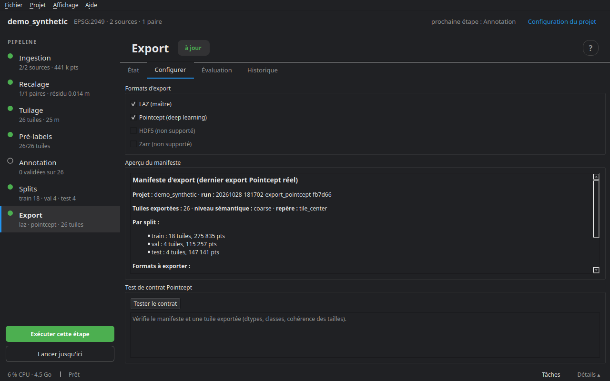

# Export et évaluation

L'export écrit le jeu de données, split par split, à partir des tuiles et de leurs labels actuels. Les tampons sont rognés selon la garde choisie aux splits : chaque point n'apparaît qu'une fois.

## Les formats

**LAZ maître** — `exports/laz/<split>/<paire>/<tuile>/{t0,t1}.laz`, avec tous les champs (classes, changement, provenance, confiance, distance mesurée…), lisibles dans CloudCompare ; plus `meta.json` et le journal d'annotation de la tuile.

**Pointcept** — `exports/pointcept/<split>/<paire>/<tuile>/<époque>/<champ>.npy`, prêt pour un chargeur d'entraînement :

- `coord` : float32, dans un repère local **commun aux deux époques** (le centre de la tuile par défaut) ;
- `color` : uint8 ; `strength` : l'intensité, normalisée par les centiles 1–99 **de la source** (pas de la tuile, pour que deux tuiles restent comparables) ;
- `segment` et `change` : int32, avec `ignore_index` (−1) là où rien n'est décidé — par défaut *unobserved* va en `ignore` ;
- `segment_src`, `change_src` : la provenance ;
- `manifest.json` récapitule les classes, les correspondances et les statistiques par split.

La sémantique s'exporte en **grandes classes** par défaut (`level: coarse`) ou en classes fines. La disposition des fichiers, le nom des champs, le repère des coordonnées, la correspondance des classes de changement et le filtre sur le statut des tuiles (par exemple n'exporter que les tuiles terminées : `only_status: [done]`) se règlent dans `project.yaml`, section `export`.

## L'onglet Configurer



- **Formats d'export** — LAZ (maître) et Pointcept ; au moins un.
- **Aperçu du manifeste** — ce qui a été exporté au dernier run (tuiles et points par split, niveau sémantique), ou ce qui le sera.
- **Tester le contrat** — vérifie le manifeste et une tuile exportée : `coord` en float32, `segment` en int32 dans les classes annoncées (ou `ignore_index`), `change` de la même longueur que `coord`. À lancer avant de brancher un chargeur d'entraînement.

## L'onglet Évaluation

Pour un projet dont les tuiles portent une **vérité terrain** — le projet de démonstration, ou des tuiles revues à part — l'évaluation compare un champ prédit à ce champ.

- **Champ vérité terrain** et **champ prédit** (par défaut `gt_change` et `change`), puis **Évaluer**.
- **Matrice de confusion** — lignes : vérité, colonnes : prédiction, avec le rappel de chaque classe.
- **Carte d'erreur par tuile** — le taux d'erreur (1 − rappel) de chaque tuile, sur la carte.
- **Carte d'erreur (points)** — chaque point en vert (juste) ou rouge (faux), sur une tuile ou un échantillon du projet.

Le résultat est écrit dans `reports/evaluation.json`, que l'onglet relit à l'ouverture.

## Le rapport

`cdforge report` écrit `reports/report.html` : les sources, le recalage, les labels et le journal des traitements. Le même rapport s'ouvre depuis **Ingestion ▸ Catalogue ▸ Exporter la fiche du jeu de données**.

## En ligne de commande

```bash
cdforge export mon_projet                 # les formats de project.yaml
cdforge export mon_projet --format laz    # un seul format
cdforge evaluate mon_projet --gt-field gt_change --pred-field change
cdforge report mon_projet
cdforge history FICHIER -p mon_projet    # comment un fichier a été produit
```

Étape suivante : [Gestionnaire de tâches](11_taches.md).
