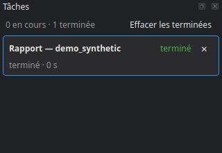

# Le gestionnaire de tâches

Tout ce qui dure — ingestion, recalage, tuilage, pré-label, inférence, téléchargement des poids, comptage des classes — passe en tâche de fond. Une règle : **une tâche ne bloque jamais l'application**. On continue de régler, de regarder une autre étape ou d'ouvrir une tuile pendant qu'elle tourne, et elle survit à la vue qui l'a lancée.

## Le panneau

Le bouton **Tâches** de la barre du bas, ou **Ctrl+T**, l'affiche ; un double-clic sur son titre, ou **Affichage ▸ Détacher les tâches dans une fenêtre**, le met dans une fenêtre à part.

Pour chaque tâche : son titre, son état (en attente, en cours, terminé, arrêté, échec), la phase en cours, la proportion faite et le **temps restant** estimé.

- **Arrêter** — demande l'arrêt ; une commande qui ne répond pas peut être fermée de force, après confirmation.
- **Journal** — la sortie de la tâche, et le chemin du journal complet sur le disque.
- **Retirer de la liste**, **Effacer les terminées**.

## Quitter pendant une tâche

Fermer le studio, ou changer de langue, annonce les tâches qui tournent encore et demande confirmation : quitter les arrête. Relancer ensuite l'étape refait ce qui n'était pas terminé.

## L'état des étapes

Chaque run terminé s'inscrit dans l'**Historique** de son étape : quand, combien de temps, son statut, ses métriques et ses paramètres. C'est ce journal qui permet de dire qu'une étape est **périmée** : sa configuration a changé depuis son dernier run réussi. **Projet ▸ Rafraîchir l'état** (F5) le relit depuis le disque.

En ligne de commande, `cdforge status` donne l'avancement des tuiles, `cdforge dag` l'enchaînement des étapes, et `cdforge history` la chaîne de traitements d'un fichier.

Étape suivante : [La ligne de commande](12_ligne_de_commande.md).
