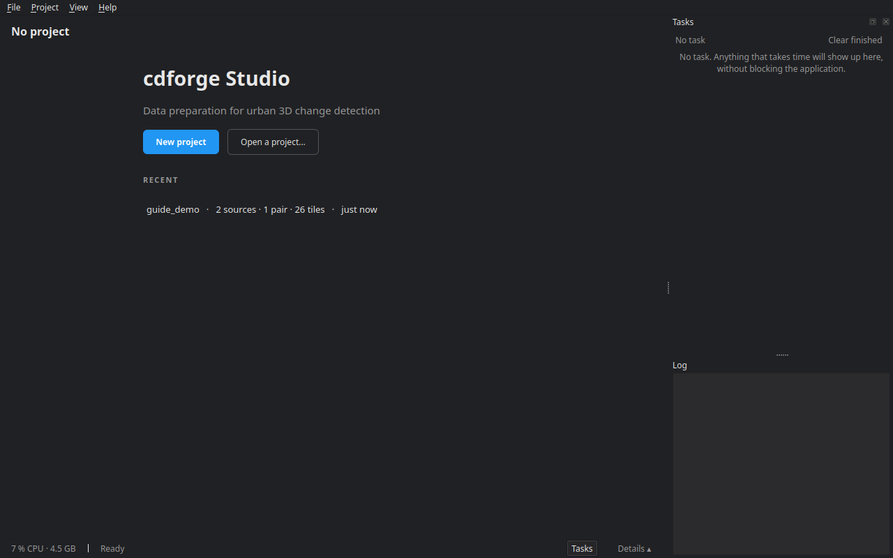
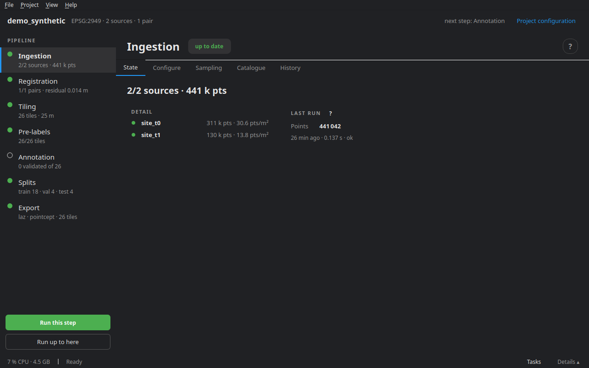

# Getting started

cdforge prepares 3D change-detection datasets: two surveys of the same place, at two dates, become tiles in which every point carries a semantic class (what it is) and a change class (what happened to it). cdforge Studio is the interface that runs the whole process, from reading the files to the export.

## Starting cdforge Studio

From a terminal:

```bash
cdforge studio
```

With the AppImage, double-click `cdforge-<version>-x86_64.AppImage` (once it is executable), or:

```bash
./cdforge-<version>-x86_64.AppImage
```

`cdforge install-launcher` adds cdforge Studio to the application menu, with its icon.

## The welcome screen



With no project open, the window offers **New project** (the creation wizard, see [Creating and configuring a project](02_project.md)), **Open a project…** (pick the folder that holds `project.yaml`) and the **recent** projects, with their sources, pairs and tiles.

## The workspace



An open project is laid out in three bands.

**The header**, at the top: the project name, its coordinate system, the number of sources and pairs, the **next step** to do, and the **Project configuration** link.

**The pipeline column**, on the left: the seven stages, in order.

1. **Ingestion** — read the sources, crop, harmonise the labels.
2. **Registration** — align the second epoch onto the first.
3. **Tiling** — cut each pair along a common grid.
4. **Pre-labels** — propose change and semantics automatically.
5. **Annotation** — correct and validate, tile by tile, in the editor.
6. **Splits** — share the tiles between train, validation and test.
7. **Export** — write the dataset.

Each stage shows a status dot — up to date, not run, **stale** (its configuration changed since the last run), failed — and a summary ("26 tiles · 25 m"). Below the column, **Run this step** runs the selected stage and **Run up to here** chains every stage before it, itself included. Annotation is not run in batch: on that stage, the button becomes **Open the annotation editor**.

**The stage pane**, in the middle, in tabs:

- **State**: the summary, the detail per source, pair or tile, and the metrics of the last run;
- **Configure**: the stage settings, written to `project.yaml`;
- tabs specific to some stages: **Sampling** and **Catalogue** (ingestion), **Tile map** (tiling), **Quality control** (pre-labels), **Editor** (annotation), **Evaluation** (export);
- **History**: every run, its duration, status, metrics and the parameters it ran with.

The **?** button, right of the title, opens this guide's chapter on the stage.

**The bottom bar** shows processor and memory use, the last message, the **Tasks** button and the **Details** button, which unfolds the details panel.

## The menus

**File** — New project (Ctrl+N), Open a project… (Ctrl+O), Quit (Ctrl+Q).

**Project** — Run the whole pipeline (the same as `cdforge run`: the stages follow one another, those already up to date are skipped); Refresh the state (F5); Project configuration; Project classes…; Change classes….

**View** — dark or light theme; details panel (Ctrl+J); tasks panel (Ctrl+T); detach the tasks into a window; **Langue / Language**: the studio offers to restart in the chosen language, and reopens the same project.

**Help** — User guide (F1), Interactive demos, the explanation documents (how pre-labelling decides on a change, SNAP semantic assistance, annotating both dates), AI module…, About.

## Key notions

**Project** — a folder: `project.yaml` (the whole configuration), `raw/` (a place for the sources, which may also live elsewhere), `work/` (intermediate files: ingested sources, registration, tasks), `tiles/` (the tiles), `exports/`, `reports/`, and `splits.json` once the split is made.

**Source** — one survey: one file or several merged strips, with its sensor (MLS, ULS, ALS, TLS…), its site, its date, and optionally a sensor trajectory and a scheme that says how to read its classes.

**Pair** — two sources of the same site: **t0**, the older, and **t1**, the more recent. They are registered and then tiled together.

**Tile** — a square of the common grid, with the points of both epochs. Its **core** belongs to it alone; its **buffer** overlaps its neighbours, so that computations near the edge see the context.

**Labels** — every point has two label layers:

- **semantic**: the object's class, in the project's class list (see [Classes](02_project.md#classes));
- **change**: *unchanged*, *added* (t1 points), *removed* (t0 points), *transient* (an object passing through) and *unobserved* (the other epoch could not see the spot). *unobserved* is filed under *unchanged*: nothing was seen to change there.

Every label keeps its **provenance**: none, imported from a source's ground truth, proposed automatically, or set by a person. An automatic label never passes for a validated one.

## Workspace shortcuts

| Key | Action |
|---|---|
| Ctrl+N | New project |
| Ctrl+O | Open a project |
| F5 | Refresh the state |
| Ctrl+J | Details panel |
| Ctrl+T | Tasks panel |
| F1 | This guide |
| Ctrl+Q | Quit |

The annotator has its own shortcuts: see [Annotation](08_annotation.md).

## What next

To try it without data, `cdforge demo` creates a synthetic project with known changes and processes it end to end; then open it in the studio. For your own surveys, start with [Creating and configuring a project](02_project.md).
