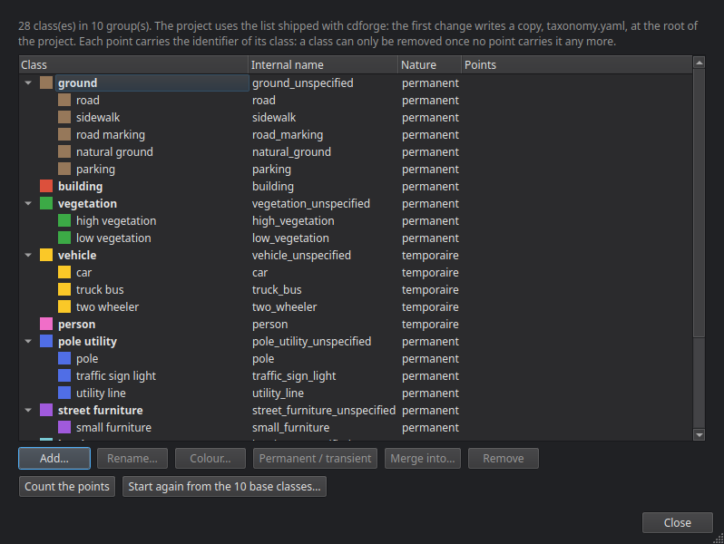
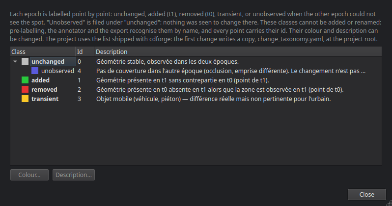

# Creating and configuring a project

A cdforge project is a folder whose whole configuration lives in `project.yaml`. You create it with the wizard (**File ▸ New project**), or on the command line with `cdforge init`, then set it up in the **Project configuration** window.

## The creation wizard

Five pages.

### 1. Basic information

The project **name**, an optional **description**, and the **folder** to create it in. The wizard prepares `raw/`, `work/`, `tiles/`, `exports/` and `logs/` there.

### 2. Coordinate system

The project **CRS**, as an EPSG code — typed, searched by name (with the `cdforge[crs]` option), or **read from a file**: a LAS/LAZ that carries one, or the `.prj` next to a file. Many files have none (a PLY has nowhere to put it); cdforge says so, and does not guess a CRS on your behalf when it only knows its name. A survey in a local frame (TLS, SLAM) has no projection: choose **No CRS (local coordinates)**, and the exports will carry none.

The **vertical datum**: CGVD2013, CGVD28, NAVD88, WGS84 ellipsoidal height, or "unknown (to be documented)".

### 3. Data sources

**Add files…** or **Add a folder…** (a folder of Pointcept-style `.npy` tiles, for instance). Several files added together: the wizard asks whether they are **strips of one source**, to be merged, or **distinct sources**.

For each source:

- **ID** — unique in the project;
- **Sensor** — MLS, ALS, ULS, TLS, SYN (synthetic) or other;
- **Site** and **Epoch** (for instance `2023-06`) — two sources of the same site make a pair;
- **Semantic scheme** — how to read the classes the file carries (`asprs_las14`, `toronto3d`, `semantickitti19`…); empty if the file has no classes;
- **Change scheme** — for a file that already carries change labels (`urb3dcd_v2`); empty otherwise;
- **Trajectory** — optional: the CSV file of the sensor positions. It lets pre-labelling cast rays from the sensor to the points (see [Pre-labelling](06_prelabels.md)).

A source may have no labels at all: that is the common case, and pre-labels are there for it. If the files added do not carry the same CRS, or not the one declared on the previous page, the wizard shows it: nothing downstream would catch it.

### 4. Detection pairs

Sources that share a site are paired automatically: the older as **t0**, the more recent as **t1**. **+ Add a pair manually** for the other cases. A purely semantic project may have no pair at all.

### 5. Summary

Everything that will be written, and the **Run the ingestion immediately** box.

## Project configuration

The **Project configuration** link in the header (or **Project ▸ Project configuration**) opens a window with tabs.

- **General** — name, format version, CRS, folder; the description is edited here.
- **Sources** — the list of sources; **Add a source** (same fields as in the wizard, with file paths separated by commas) and **Remove**.
- **Pairs** — **Create a pair** (t0, t1) and **Remove the selected pair**.
- **Classes** — the project's semantic class list (below).
- **Change classes** — their colours and descriptions (below).
- **Parameters** — the settings of every stage, read-only: they are changed in each stage's **Configure** tab, or in the YAML tab.
- **YAML** — `project.yaml` as is. **Save the YAML** checks the file before writing it: an invalid file is not saved.

## Classes

**Project ▸ Project classes…**, or the **Classes** tab of the configuration.



Every project starts from **10 base classes**: ground, building, vegetation, vehicle, person, pole_utility, street_furniture, barrier, water, other. Names are in English, and the name is what is shown. The wizard and `cdforge init` write them to `taxonomy.yaml` at the project root; a project that still points to a list shipped with cdforge gets a copy at the first change — the package's list is never modified.

- **Add…** — a finer class **under a base class** (`street_light` under `pole_utility`: the base-class export counts it in its group), or a **new base class** (`rail`); you then say whether what it designates is **permanent** or **transient**.
- **Rename…** — the old name is still understood: scheme translations that cite it still point to this class.
- **Colour…**
- **Permanent / transient** — applies to the whole group. In the annotator, a change carried by a transient class (a car parked at t0, gone at t1) can be requalified as *transient*.
- **Merge into…** — remaps one class onto another across the project: every point that carries it, in every layer of every tile, moves to the other; then it leaves the list.
- **Remove** — only if no point carries it any more. **Count the points** reads the labels of every tile to find out. A point stores its class id: removing the class from under it would make it "out of taxonomy" without anything flagging it.
- **Start again from the 10 base classes…** — keeps those still carried by points.

A semantic model may predict classes the list lacks: they are added or filed when harmonising the model (see [Semantic models](07_ai.md)).

## Change classes

**Project ▸ Change classes…**, or the tab of the same name.



Five classes, with fixed ids: *unchanged* (0), *added* (1), *removed* (2), *transient* (3), *unobserved* (4), the last filed under *unchanged*. They cannot be added or renamed: pre-labelling, the annotator and the export recognise them by name. Their **colour** and **description** can be changed; as with the semantic classes, the first change writes a copy into the project, `change_taxonomy.yaml`.

## On the command line

```bash
cdforge init my_project       # commented project.yaml and folders
cdforge validate my_project   # checks project.yaml, the source files and the schemes
```

Next step: [Ingestion](03_ingestion.md).
