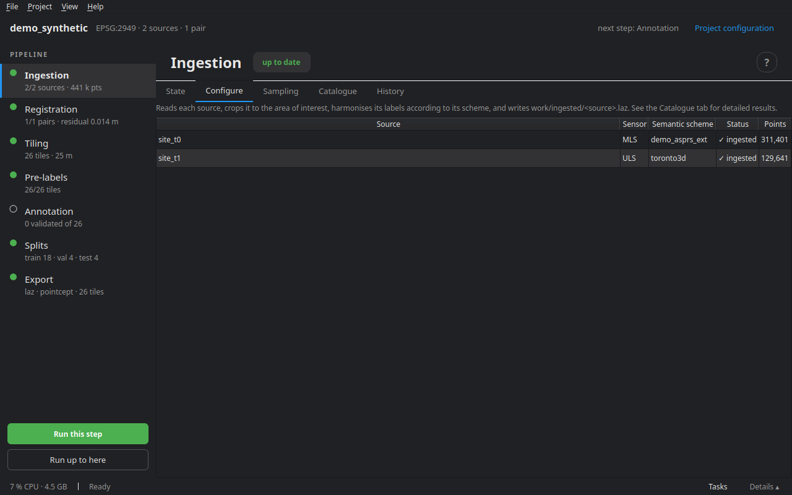
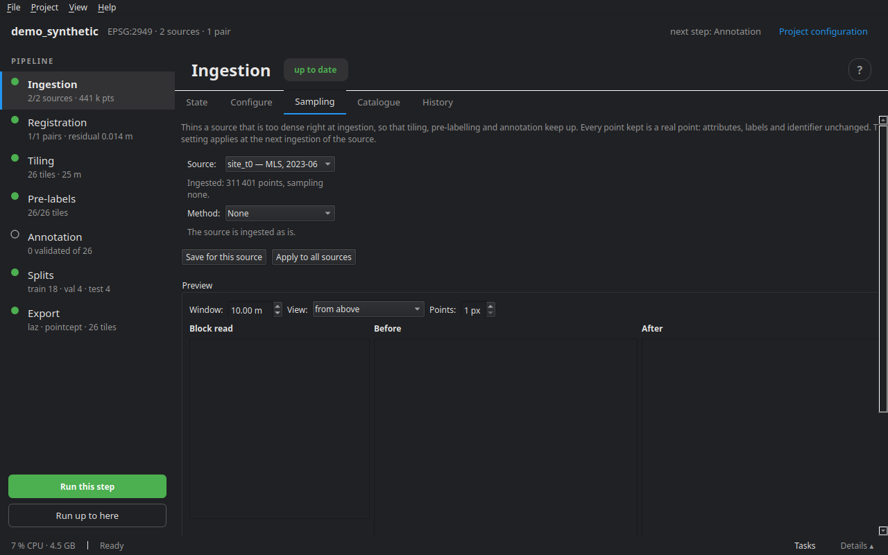

# Ingestion

Ingestion reads every source, crops it to the area of interest, harmonises its labels with its scheme and writes a standard version, `work/ingested/<source>.laz`, with its statistics next to it (`<source>.json`). Every later stage starts from there.

## Formats read

| Format | Extensions | Note |
|---|---|---|
| LAS, LAZ | `.las`, `.laz` | classes, intensity, colour, GPS time, extra dimensions; the CRS if written in the file |
| PLY | `.ply` | ASCII or binary |
| E57 | `.e57` | every scan in the file, each placed by its pose; shots with no return are dropped |
| PCD | `.pcd` | ASCII or binary (not the compressed variant) |
| PTS | `.pts` | a count line, then `x y z [intensity] [r g b]` |
| PTX | `.ptx` | each scan is placed with its matrix; shots without a return are dropped |
| Text | `.txt`, `.xyz`, `.csv`, `.asc` | a header line names the columns; without one, the first three are x, y, z |
| NPZ | `.npz` | named NumPy arrays |
| `.npy` folder | a folder | Pointcept style: `coord.npy`, `color.npy`, `segment.npy`… |

Several files of the same source — the strips of a mobile survey, for instance — are merged into one source.

## Schemes: reading a source's classes

A file that already carries classes numbers them its own way. The source's **semantic scheme** says which project class each of its codes maps to. cdforge ships schemes for ASPRS LAS 1.4, DALES, Paris-Lille-3D, SensatUrban, Toronto-3D, SemanticKITTI, nuScenes, Waymo and a few others; `cdforge validate` checks the project, its files and its schemes. The **change scheme** does the same for a source carrying change labels (Urb3DCD).

Without a scheme, the source is read as geometry only: pre-labels will propose the classes.

## The Configure tab



The list of sources, with their sensor, semantic scheme, status (pending, ingested) and number of points. The sources themselves are declared in the **Project configuration** (see [Creating and configuring a project](02_project.md)). **Run this step** ingests those not yet ingested, or whose setting changed.

## The Sampling tab



Thins a source that is too dense right at ingestion, so that tiling, pre-labelling and annotation can keep up. Every point kept is a real point: its attributes, labels and id are unchanged.

| Method | What it keeps |
|---|---|
| **None** | everything: the source is ingested as is |
| **Random** | every point with the chosen probability; the same seed keeps the same points |
| **One point in N** | in file order — for a mobile survey, acquisition order. The fastest |
| **Voxel** | one point per cube of the chosen edge: only thins where it is denser than the grid |
| **FPS** (farthest point) | at every step, the point farthest from those already kept: the most even spacing, computed by groups of neighbouring points |

The **preview** applies the setting to the first block of the source, seen from above or in section, before and after: points in the window, density, median spacing, and an estimate for the whole source. **Save for this source**, or **Apply to all sources** — t0 and t1 thinned the same way. If the two epochs of a pair are not, the tab says so: a density difference can read as a change. The next ingestion redoes the sources whose setting changed.

## The Catalogue tab

One row per ingested source: site, epoch, sensor, number of points, density, and its **trajectory**. **Trajectory…** associates the CSV file of the sensor positions with a source, or removes it. **Export the dataset sheet** writes and opens `reports/report.html`: sources, registration, labels, processing log.

## The State tab

For each source: the number of points and the density (points/m²); then the metrics of the last run.

## On the command line

```bash
cdforge ingest my_project
```

Next step: [Registration](04_registration.md).
