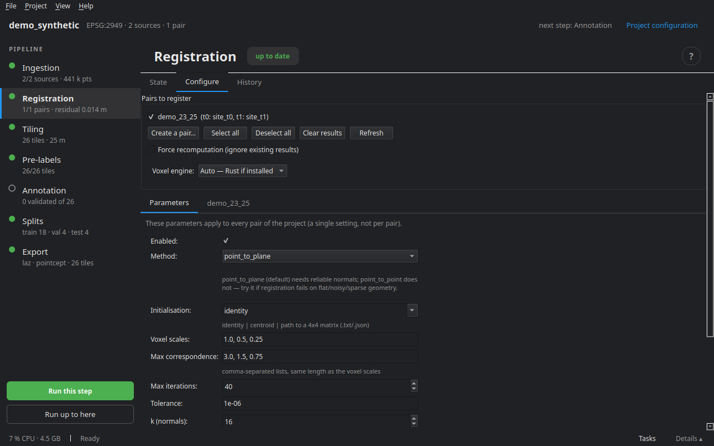

# Registration

Two surveys of the same place never land exactly on top of each other: positioning drift, calibration, georeferencing. Registration looks for the rigid transform (rotation and translation) that brings **t1 onto t0**. It is written to `work/align/<pair>.json`; the ingested files are not rewritten — tiling applies it to the t1 points.

Without registration, a wall that has not moved appears shifted by a few centimetres, and pre-labelling takes it for a change.

## How it works

A robust, multi-scale ICP (*iterative closest point*):

1. both epochs are read in full and thinned on a voxel grid — the longest phase on a large survey;
2. ICP runs first at the coarsest scale, then refines: at every scale (`voxel_scales`, by default 1, 0.5, 0.25 m), a correspondence is only kept below a maximum distance (`max_corr`, 3, 1.5, 0.75 m);
3. a robust weighting (Tukey by default, or Huber) sets aside what really changed, which must not pull the transform.

At the end, the **NMAD of the residuals** (a robust measure of their spread) is kept as the **registration error**: by default, it enters the detection threshold of pre-labelling (see [Pre-labelling](06_prelabels.md)).

## The Configure tab



**Pairs to register**, with **Select all**, **Deselect all**, **Clear the results** (deletes the transforms of the ticked pairs) and **Refresh**. **Force recomputation** ignores existing results.

**Input data** — for each epoch: the number of points and the file size, or what is missing (not ingested, file missing). A duration estimate follows.

**Parameters** — shared by every pair of the project:

| Setting | Role |
|---|---|
| Enabled | without registration, the transform stays the identity |
| Method | `point_to_plane` (default) needs reliable normals; `point_to_point` does not — try it when registration fails on flat, noisy or sparse geometry |
| Initialisation | `identity`, `centroid`, or the path of a 4×4 matrix (`.txt`, `.json`) when the surveys are far apart |
| Voxel scales, Max correspondence | two lists of the same length, from coarsest to finest |
| Max iterations, Tolerance | when each scale stops |
| k (normals) | neighbours used to estimate normals |
| Robust | `tukey`, `huber` or `none` |
| Stable classes | register on some classes only (for instance `ground, building`) when the sources have labels; empty = everything |
| Max points, Chunk size | the point budget per scale and the size of the read blocks |

**Voxel engine**: Rust when installed, Python otherwise. Both keep the same points and give the same transform.

## Reading the result

The **State** tab and the **Registration results** give the rotation (in degrees), the translation, the NMAD of the residuals, the inlier fraction and the **condition number** — global values for the pair.

- An NMAD of a few centimetres, on a mobile survey, is the expected order; it tells the error left where nothing changed.
- A very high condition number means one direction is poorly constrained: a long street without façades, flat terrain. Stable classes or a given initialisation help.
- A rotation of several degrees between two georeferenced surveys points to an error (CRS, wrong pair) rather than a real offset.

## On the command line

```bash
cdforge align my_project
```

Next step: [Tiling](05_tiling.md).
