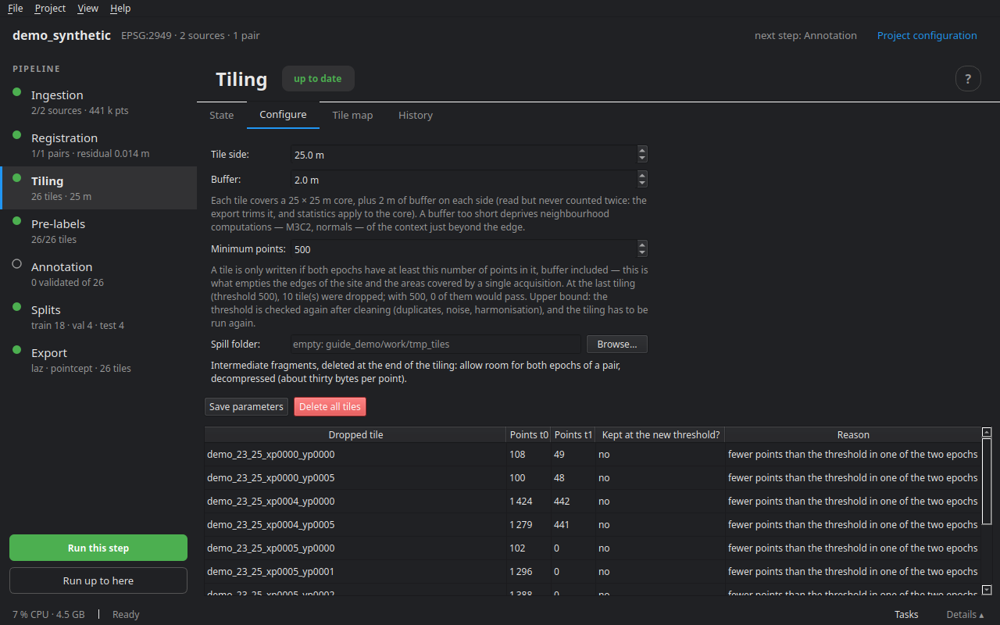
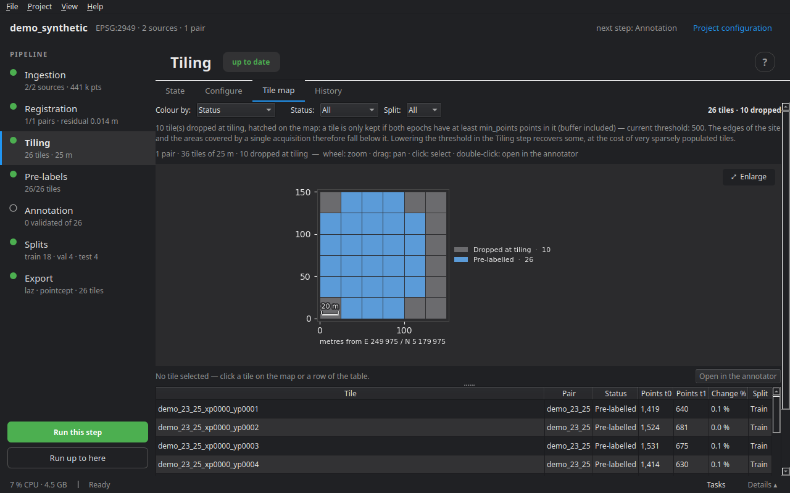

# Tiling

Tiling cuts each pair along a grid shared by both epochs: a tile holds the t0 and t1 points over the same footprint, t1 already brought in by registration. It is the unit of everything that follows — pre-labelling, annotation, split, export.

## Core and buffer

Each tile has a **core** of `size × size` metres, which belongs to it alone, and a **buffer** of `overlap` metres on each side, taken from its neighbours. The buffer is read so that neighbourhood computations (normals, M3C2 cylinders, rays) see the context at the edge, but it is never counted twice: the export crops it, statistics cover the core, and the split takes it into account to avoid leaks between train and test (see [Splits](09_splits.md)).

Each tile is cleaned on the way, the same way for both epochs: duplicates closer than `dedup_eps` (1 mm) are removed.

## The point threshold

A tile is only written if **both** epochs have at least `min_points` points in it, buffer included. That is what empties the edges of the survey and the areas only one epoch covers. Skipped tiles stay listed — on the map and in `skipped.json` — with their reason and their point counts; the table of the Configure tab tells which would come back with another threshold.

## The Configure tab



| Setting | Role |
|---|---|
| Tile side | what you see at once when annotating; 25 to 50 m for an urban survey |
| Buffer | what neighbourhood computations find at the edge; at least the pre-label measurement radius |
| Minimum points | the threshold above |
| Spill folder | where the intermediate fragments go, deleted at the end: allow about thirty bytes per point for both epochs of a pair. An SSD helps a lot when the project is on a hard disk |

**Save parameters** writes them to `project.yaml`; they change nothing in tiles already written. **Run this step** opens the choice of pairs to tile (**Only the new ones**, or all), the number of **tiles in parallel** and the **spill engine** (Rust when installed). An estimate of the number of grid cells is shown before starting.

**Delete all tiles** deletes the tiles of every pair, annotations included, after confirmation.

### Retiling an annotated project

Every point gets a stable id at ingestion. Labels set by hand follow it: changing the size, the buffer or the origin of the grid and retiling gives them back to the same points, in the new tiles.

## The Tile map tab



The grid seen from above, one cell per tile, with a table beside it (tile, pair, status, split, change rate).

- **Colour by**: status (tiled, pre-labelled, in progress, validated, rejected), split, change rate (share of core points marked changed), uncertainty (1 − mean confidence) or number of points.
- **Filters**: pair, status, split.
- Hovering a tile gives its status, split, t0 and t1 points, change and uncertainty; a skipped tile, its reason.
- **Double-click**, or **Open in the annotator**: opens the tile in the editor.

## On disk

```
tiles/<pair>/
  tiles.geojson              # the footprint of every tile
  skipped.json               # skipped tiles and why
  <tile>/
    meta.json                # footprint, core, counts, state
    t0.laz, t1.laz           # geometry and attributes
    labels/<layer>/          # the labels, by layer
      t0_semantic.npz, t0_change.npz, t1_semantic.npz, t1_change.npz
```

## On the command line

```bash
cdforge tile my_project
cdforge status my_project     # tile progress per pair
```

Next step: [Pre-labelling](06_prelabels.md).
