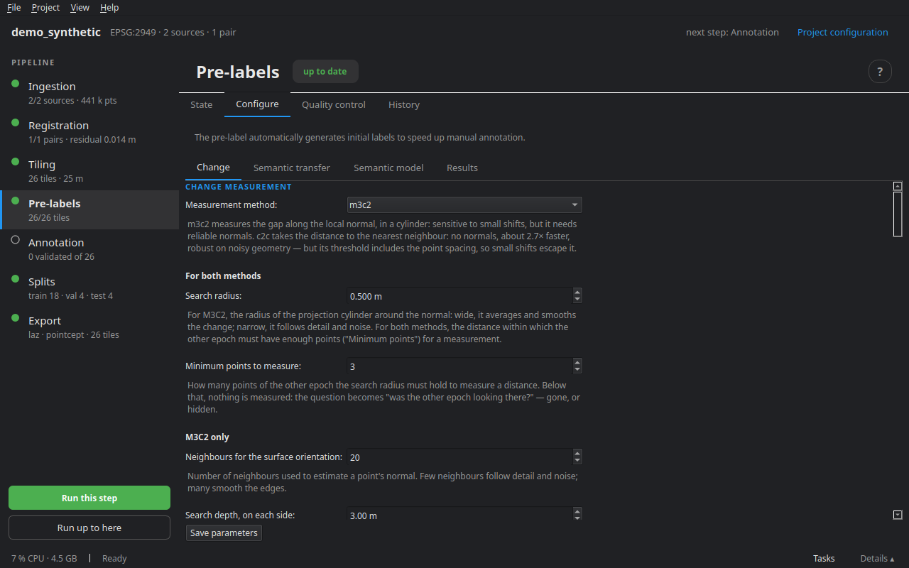

# Pre-labelling

Pre-labelling proposes, for every point of every tile, a change class and a semantic class, with a **confidence**. It does not replace annotation: it prepares it. Labels imported from a ground truth and labels set by hand are **never** overwritten; automatic labels keep their provenance, and the annotator always knows what is left to check.

The full detail of the change decision, setting by setting, is in **Help ▸ [How the pre-label decides on a change](../../changement_et_rayons.en.md)**.

## Change

Each epoch is labelled in turn against the other, **with exactly the same code**: t0 points come out *unchanged*, *removed* or *unobserved*; t1 points, *unchanged*, *added* or *unobserved*. For a point of epoch A, facing the other epoch B:

1. **Measure** — does B have at least `min_pts` points facing it, within the search radius?
2. If so, **the distance decides**: above the threshold, the point has changed (*added* or *removed*); below it, it is *unchanged*.
3. If not, the question becomes **"was B looking at this spot?"** — yes: the object disappeared (or appeared); no: *unobserved*, a blind spot where nothing can be decided.
4. **Cleaning** — a cluster of changed points smaller than `min_cluster` is reset to *unchanged*: a real change has an extent.

*transient* is never decided here: a car parked at t0 and gone at t1 comes out *removed*. The annotator offers to requalify as *transient* the changes carried by a transient class (see [Annotation](08_annotation.md)).

### Two measurement methods

**M3C2** (default) measures the gap along the local normal, in a cylinder, and computes a **per-point detection threshold** (LoD95) from the roughness of both clouds and the registration error. Sensitive to small displacements, it needs reliable normals. The **same surface** rule keeps, in the cylinder of a planar point, only the neighbours oriented like it: a ground point's cylinder no longer catches the neighbouring wall.

**C2C** takes the distance to the nearest neighbour: no normals, about 2.7 times faster, robust on noisy or sparse geometry. On auto, its threshold is 1.96 × the registration error **plus the point spacing** — two surveys of the same surface never land exactly on top of each other — so small displacements escape it. It can also be **set by hand**.

### "Was B looking at this spot?"

- **Coverage**, always computed: does B have a point in the same ground cell, a nearby point (`obs_radius`), points on enough sides (`obs_quadrants`)? Each part can be switched off on its own. It confuses an occlusion that leaves points nearby with a disappearance.
- **Rays**, when source B has a **trajectory**: does the line from the sensor to the point cross empty space (the spot was seen, the object is gone) or an obstacle (it was hidden)? They really decide, but only where a viewpoint exists; elsewhere, coverage answers.

## Semantics

Several sources, which complement each other, never overwriting an imported or manual label:

- **the source's classes**, read at ingestion through its scheme;
- **the built-in geometric model**: the local shape of the cloud — height above ground, linearity, planarity, scatter, verticality — tells ground, buildings, vegetation, poles apart; no dependency;
- **transfer between epochs**: an unchanged point without a class gets the majority vote of its `transfer_k` nearest labelled neighbours in the other epoch (confidence = vote share); a changed point never inherits;
- **a deep-learning model**, run from the Semantic model tab or imported (see [Semantic models](07_ai.md)).

The **ground by cloth simulation** (CSF) is tuned in the annotator, on a tile you are looking at, then applied to the others.

## The Configure tab



Four sub-tabs.

**Change**

- *Change measurement*: the method, then three groups — **for both methods** (search radius, minimum points to measure), **M3C2 only** (neighbours for the surface orientation, search depth, maximum points per cylinder, same surface: angle and planarity), **C2C only** (change threshold, auto or set). What does not apply to the chosen method is greyed out.
- *What the other epoch observed*: the three parts of coverage, then rays — when to cast them, voxel size, viewpoints tried and their spacing, range, what to ignore around the sensor and around the point, what rays are allowed to change.
- *Cleaning*: smallest change kept, clustering distance.
- *Registration uncertainty*: the registration NMAD (auto) or a value.
- *Execution*: the neighbourhood engine (Rust when installed) and the number of tiles in parallel — choices for this run, not project settings.

Under each field, what it does. **Restore defaults** resets the tab without writing anything; **Save parameters** writes `project.yaml`.

**Semantic transfer** — switch it on, and the number of neighbours in the vote.

**Semantic model** — the geometric model (enable, neighbourhood, ground, object thresholds) and the catalogue of deep-learning models (see [Semantic models](07_ai.md)).

**Results** — what the last pre-labelling produced: the change labels of t0 and t1, the share decided by rays and by coverage, and the points where the ray concluded otherwise than coverage.

## The Quality control tab

**Check quality** reads the pre-label reports and lists, per tile, what deserves a look: many isolated clusters reset to *unchanged*, a high share of *unobserved* (an edge of coverage?), a low change confidence. **Open** leads to the tile. **Count the classes** gives the distribution of semantic classes over the tile cores.

## Seeing a decision

In the annotator, the **R** key on a point replays its decision, step by step, with the rays drawn. It is the most direct way to understand a surprising label, and to know which setting would change it.

## On the command line

```bash
cdforge prelabel my_project
cdforge import-predictions FOLDER my_project   # <tile>/<epoch>_semantic.npy, made elsewhere
```

Next step: [Semantic models](07_ai.md), or straight to [Annotation](08_annotation.md).
