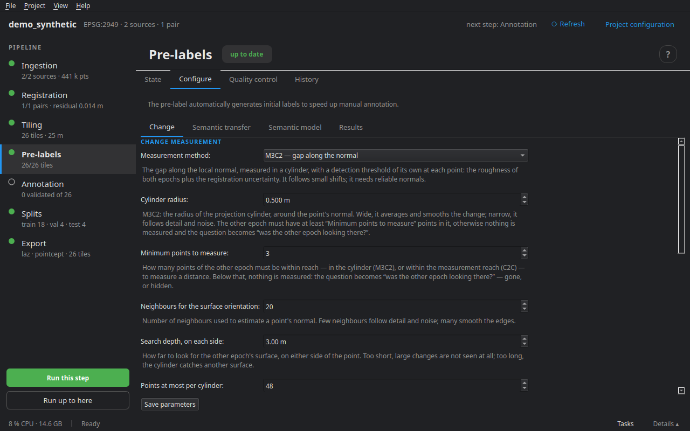

# Pre-labelling

Pre-labelling proposes, for every point of every tile, a change class and a semantic class, with a **confidence**. It does not replace annotation: it prepares it. Labels imported from a ground truth and labels set by hand are **never** overwritten; automatic labels keep their provenance, and the annotator always knows what is left to check.

The full detail of the change decision, setting by setting, is in **Help ▸ [How the pre-label decides on a change](../../changement_et_rayons.en.md)**.

## Change

Each epoch is labelled in turn against the other, **with exactly the same code**: t0 points come out *unchanged*, *removed* or *unobserved*; t1 points, *unchanged*, *added* or *unobserved*. For a point of epoch A, facing the other epoch B:

1. **Measure** — does B have at least `min_pts` points facing it: in the point's cylinder (M3C2), or within the measurement reach (C2C)?
2. If so, **the distance decides**: above the threshold, the point has changed (*added* or *removed*); below it, it is *unchanged*.
3. If not, the question becomes **"was B looking at this spot?"** — yes: the object disappeared (or appeared); no: *unobserved*, a blind spot where nothing can be decided.
4. **Cleaning** — a cluster of changed points smaller than `min_cluster` is reset to *unchanged*: a real change has an extent.

*transient* is never decided here: a car parked at t0 and gone at t1 comes out *removed*. The annotator offers to requalify as *transient* the changes carried by a transient class (see [Annotation](08_annotation.md)).

### Two measurement methods

**M3C2** (default) measures the gap along the local normal, in a cylinder, and computes a **per-point detection threshold** (LoD95) from the roughness of both clouds and the registration error. Sensitive to small displacements, it needs reliable normals. The **same surface** rule keeps, in the cylinder of a planar point, only the neighbours oriented like it: a ground point's cylinder no longer catches the neighbouring wall.

**C2C** takes the distance to the nearest neighbour: no normals, about 2.7 times faster, robust on noisy or sparse geometry. On auto, its threshold is 1.96 × the registration error **plus the point spacing** — two surveys of the same surface never land exactly on top of each other — so small displacements escape it. It can also be **set by hand**.

C2C sets two distances, which answer two questions one after the other:

1. **The measurement reach** (0.5 m by default): *can this point be measured?* The other epoch is searched around it, up to this distance. If there are not enough points (`min_pts`), nothing is measured: coverage or rays tell whether the other epoch was looking at the place — if so, the point is gone; if not, it was hidden.
2. **The change threshold** (on auto, the registration error plus the point spacing): *has the measured point moved?* It absorbs the normal gap between two surveys of the same surface.

For example, with a 0.5 m reach and a 3 cm threshold, the nearest point of the other epoch is:

| at… | verdict |
|---|---|
| 1 cm | unchanged |
| 20 cm | changed |
| nothing within 0.5 m | no measurement: gone or hidden |

The threshold must therefore stay **smaller than the reach**: a measured distance never exceeds the reach, and a threshold above it would never be crossed. The form writes these three cases with your values, and warns when the threshold reaches the reach.

### "Was B looking at this spot?"

- **Coverage**, always computed, and the only answer without a trajectory. We do not know where B was looking from: we only check whether it has points all around. The point is **observed** if B has a point in the same ground cell (1 m by default) **or** within 2 m (`obs_radius`), **and** points in at least 3 of the 4 quarters around it (`obs_quadrants`) — points on one side only are the edge of the survey. Observed → gone; otherwise → *unobserved*. Each part can be switched off on its own. **Its limit**: it does not see what hides. A façade masked by a truck has the truck right next to it, passes for observed, hence gone — a false change.
- **Rays**, when source B has a **trajectory**: does the line from the sensor to the point cross empty space (the spot was seen, the object is gone) or an obstacle (it was hidden)? They really decide, but only where a viewpoint exists; elsewhere, coverage answers.

## Semantics

Several sources, which complement each other, never overwriting an imported or manual label:

- **the source's classes**, read at ingestion through its class mapping;
- **the built-in geometric model**: the local shape of the cloud — height above ground, linearity, planarity, scatter, verticality — tells ground, buildings, vegetation, poles apart; no dependency;
- **transfer between epochs**: an unchanged point without a class gets the majority vote of its `transfer_k` nearest labelled neighbours in the other epoch (confidence = vote share); a changed point never inherits. Both epochs vote with what they carry apart from the transfer. Each run first undoes the previous transfer, then redoes it if it is on: rerunning the pre-label does not spread it further, and switching it off removes what it had set, except what a gesture or an import has taken over since;
- **a deep-learning model**, run from the Semantic model tab or imported (see [Semantic models](07_ai.md)).

The **ground by cloth simulation** (CSF) is tuned in the annotator, on a tile you are looking at, then applied to the others.

## The Configure tab



Four sub-tabs.

**Change**

- *Change measurement*: the method, with what it measures, then **only its settings** — the cylinder radius (M3C2) or the measurement reach (C2C), and the minimum points to measure; for M3C2, the neighbours for the surface orientation, the search depth, the maximum points per cylinder, and the same surface (angle and planarity); for C2C, the change threshold, auto or set. Under the threshold, what auto is worth on this project — estimated from the registration and the point spacing, then measured on the last run — and a warning when the threshold reaches the measurement reach. Switching methods switches the fields shown; the other method's values stay saved.
- *Execution*: the neighbourhood engine (Rust when installed) and the number of tiles in parallel — choices for this run, not project settings.
- *Advanced settings*, folded by default, and unfolded on their own when one of them differs from its default; the fold's button says how many do:
  - *What the other epoch observed*: the three parts of coverage, then rays — when to cast them, voxel size, viewpoints tried and their spacing, range, what to ignore around the sensor and around the point, what rays are allowed to change. At the top of the rays, the sources that have a readable trajectory; with none, the ray settings are greyed out — a trajectory is declared per source, in Ingestion ▸ Catalogue;
  - *Cleaning*: smallest change kept, clustering distance;
  - *Registration uncertainty*: the registration NMAD (auto — the box says what it is worth on this project) or a fixed value.

  The numeric settings for rays and cleaning have a box: **unchecked**, the field is greyed out and the default value applies; **checked**, your value is used. Unchecking restores the default. The coverage boxes keep their meaning: unchecked, that part no longer counts.

Under each field, what it does. **Restore defaults** resets the tab without writing anything; **Save parameters** writes `project.yaml`. While the form differs from the file, “Unsaved changes” shows next to the button, and **Run this step** saves them before running. A refused save — an invalid value — runs nothing, and the reason shows in the same place.

**Semantic transfer** — off by default: it copies what the other epoch carries, right or wrong, onto everything that did not move. Switch it back on when an epoch carries human labels. The number of neighbours in the vote is greyed out while it is off.

**Semantic model** — the catalogue of deep-learning models (see [Semantic models](07_ai.md)), then the geometric model: switch it on, and its **decision thresholds**, folded and grouped by rule — neighbourhood, ground, pole, building, vegetation, in the order the rules apply. Each one is explained under its field and has a box, like the advanced settings; **Reset the thresholds** puts back the defaults, the ones behind the figures quoted.

**Results** — what the last pre-labelling produced: the measurement used and, for C2C, the threshold applied (auto: median and range over the tiles; or set), the change labels of t0 and t1, the share decided by rays and by coverage, and the points where the ray concluded otherwise than coverage.

## The Quality control tab

**Check quality** reads the pre-label reports and lists, per tile, what deserves a look: many isolated clusters reset to *unchanged*, a high share of *unobserved* (an edge of coverage?), a low change confidence. **Open** leads to the tile. **Count the classes** gives the distribution of semantic classes over the tile cores.

## Seeing a decision

In the annotator, the **R** key on a point replays its decision, step by step, with the rays drawn. It is the most direct way to understand a surprising label, and to know which setting would change it.

## On the command line

```bash
cdforge prelabel my_project
cdforge import-predictions FOLDER my_project   # <tile>/<epoch>_semantic.npy, made elsewhere
```

Next step: [Semantic models](07_ai.md), or straight to [Annotation](08_annotation.md).
