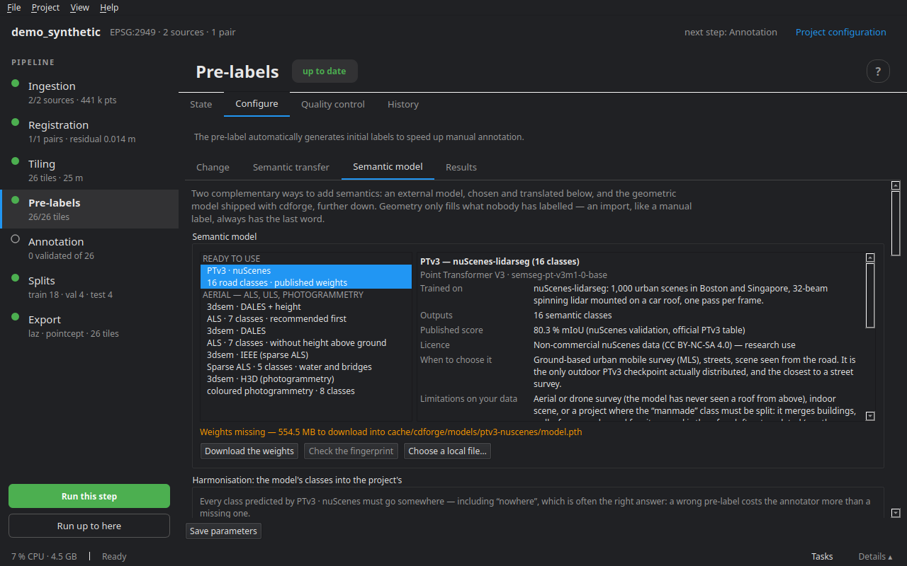

# Semantic models

A deep-learning model can lay down a first semantics on tiles that have none. cdforge does not depend on torch: the model runs in another interpreter — the ready-made **AI module**, or an environment you already have — and its predictions come back as pre-labels, with their provenance. Everything happens in the **Pre-labels ▸ Configure ▸ Semantic model** stage.

## The catalogue



The catalogue only lists models cdforge can **really run**, with published weights whose size and fingerprint it knows.

| Model | Group | For which data |
|---|---|---|
| **PTv3 · nuScenes** | ready to use | mobile or vehicle-mounted lidar, road scene: 16 classes — driveable surface, sidewalk, terrain, vegetation, eight kinds of vehicles, pedestrians, cones, barriers, and *manmade* for everything built |
| **3dsem · DALES** (with height above ground) | aerial | airborne lidar: 7 classes — recommended first |
| **3dsem · DALES** | aerial | the same without height above ground |
| **3dsem · IEEE** | aerial | sparse airborne lidar: 5 classes, including water and bridges |
| **3dsem · H3D** | aerial | coloured photogrammetry: 8 classes |

For each model, the card says what it was trained on, what it outputs, its published score, its limits on your data and when to choose it. A model trained elsewhere is loaded with **Choose a local file…**: its path replaces the download.

**Download the weights** puts them in the cdforge cache; **Check the fingerprint** compares them to the expected SHA-256. 3dsem models install with their own environment (**Install with 3dsem**).

## Harmonisation: from the model's classes to the project's

Every class the model predicts must go somewhere — including **nowhere**, often the right answer: a wrong pre-label costs the annotator more than a missing one.

The table gives, for each model class, the project class it is filed into. Three **presets**:

- **Translation shipped with cdforge** — taken class by class from the training dataset's documentation;
- **Keep the model's classes** — adds to the project those it lacks (`car` under `vehicle`, for instance), to keep the model's detail;
- **Leave everything unlabelled** — to start from scratch.

**Project classes…** opens the class editor, to add a class where one is missing. **Save the scheme in the project** writes the translation to `schemes/`: a file like any other, readable and versionable.

## Getting the predictions

### Running the inference

- **Interpreter**: the AI module when installed, or a Python with torch that **Detect** finds by actually trying each one on the machine.
- **Input channels**: what the model receives (intensity, for instance), among what your tiles have.
- **Compute**: GPU (CUDA) or processor — which works, but takes several minutes per tile where a GPU takes a few seconds.
- **Voxel grid**: zero keeps the training one, and that is the right choice.
- **Tiles per batch**, **batches in parallel**: to fill the GPU.
- **Minimum confidence** and **points below the threshold**: left unlabelled (default), or labelled and flagged uncertain.
- **Before writing**: add to the existing pre-labels (default), or clear the automatic pre-labels first.

**Prepare the tiles and run the inference**: progress shows in the tasks panel.

### Importing predictions made elsewhere

A `<tile>/<epoch>_semantic.npy` folder (one class id per point, in the tile's point order), the model name and its class scheme. Same confidence threshold, same choice before writing. On the command line: `cdforge import-predictions FOLDER my_project`.

Either way, the model, the weights fingerprint, the scheme and the threshold are written with each tile. Manual labels and ground truth are never touched.

## The AI module

**Help ▸ AI module…** — a self-contained Python carrying torch, CUDA, Pointcept and SNAP, precompiled: about 3 GB to download, once. It runs **PTv3** for pre-labelling and **SNAP** for assisted annotation (see [Annotation](08_annotation.md)), on an NVIDIA card. The rest of cdforge works without it.

- **Install** — downloads and installs; an interrupted installation resumes where it stopped.
- **From a folder…** — from a folder holding `module.json` and its parts (USB stick, download made elsewhere).
- **Check** — runs the test on the card again: a real computation per part.
- **Uninstall**.

As long as it is not installed, a banner offers it in the workspace; **Don't ask again** silences it.

## On the command line

```bash
cdforge models                               # the catalogue
cdforge fetch-weights ptv3-nuscenes          # download and check weights
cdforge stage-inference ptv3-nuscenes my_project   # prepare the tiles, print the command
```

Next step: [Annotation](08_annotation.md).
