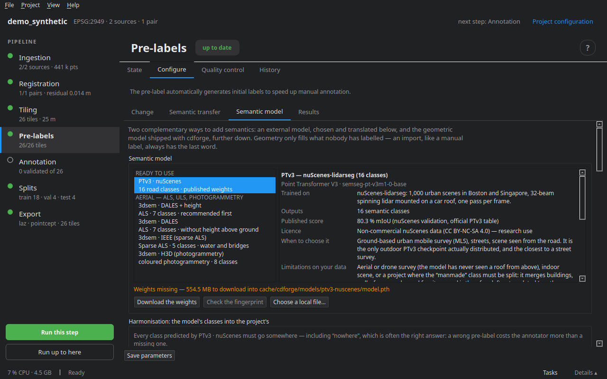

# Semantic models

A deep-learning model can lay down a first semantics on tiles that have none. cdforge does not depend on torch: the model runs in another interpreter — the ready-made **AI module**, or an environment you already have — and its predictions come back as pre-labels, with their provenance. Everything happens in the **Pre-labels ▸ Configure ▸ Semantic model** stage.

## The catalogue



The catalogue only lists models cdforge can **really run**, with published weights whose size and fingerprint it knows.

| Model | Group | For which data |
|---|---|---|
| **LitePT-S · nuScenes** | ready to use | mobile or vehicle-mounted lidar, road scene: the 16 classes of PTv3 nuScenes, with a network 3.6 times smaller |
| **LitePT-S · Waymo** | ready to use | the same scene in 22 classes, the finest: trunk and foliage, sign and pole, curb and sidewalk |
| **PTv3 · nuScenes** | ready to use | mobile or vehicle-mounted lidar, road scene: 16 classes — driveable surface, sidewalk, terrain, vegetation, eight kinds of vehicles, pedestrians, cones, barriers, and *manmade* for everything built |
| **3dsem · DALES** (with height above ground) | aerial | airborne lidar: 7 classes — recommended first |
| **3dsem · DALES** | aerial | the same without height above ground |
| **3dsem · IEEE** | aerial | sparse airborne lidar: 5 classes, including water and bridges |
| **3dsem · H3D** | aerial | coloured photogrammetry: 8 classes |
| **PTv3 · ScanNet**, **LitePT-S · ScanNet** | indoor | rooms captured with colour: 20 classes (walls, floor, furniture) |
| **PTv3 · ScanNet200** | indoor | the same rooms in 200 object classes |
| **PTv3 · S3DIS** | indoor | office buildings: 13 classes, structure more than furniture |
| **LitePT · Structured3D** (S, B, L) | indoor | homes: 25 classes, ceiling and structure included |

For each model, the card says what it was trained on, what it outputs, its published score, its limits on your data and when to choose it. A model trained elsewhere is loaded with **Choose a local file…**: its path replaces the download.

**Download the weights** puts them in the cdforge cache; **Check the fingerprint** compares them to the expected SHA-256. For LitePT, the first download also brings the network's code (its own repository, a pinned and verified version). 3dsem models install with their own environment (**Install with 3dsem**).

### Indoor models

They learned on rooms, with per-point **colour** and **normals**, and predict “wall”, “floor”, “bed” or “shower curtain”. No mapping is provided: the table is where you say what you keep. The **Also show indoor models** box removes them from the list.

cdforge prepares their input on both epochs of a tile at once, so that they are treated alike: one frame (centre of the common extent, lowest point at zero), normals estimated on the points the grid keeps and turned towards one viewpoint, and colour only if **both** epochs have it — otherwise a neutral grey for both, so the network does not see a change of material.

### Published PTv3 weights

They were trained before a Pointcept structure fix (March 2024): loaded as they are into a recent Pointcept, they load without error and predict wrong. cdforge gives the network back the structure they learned with — without it, 46 % accuracy instead of 97 % on a demo ScanNet room. PTv3 predictions made with cdforge before the version that carries this fix should be redone.

## Harmonisation: from the model's classes to the project's

Every class the model predicts must go somewhere — including **nowhere**, often the right answer: a wrong pre-label costs the annotator more than a missing one.

The table gives, for each model class, the project class it is filed into. Three **presets**:

- **Mapping shipped with cdforge** — taken class by class from the training dataset's documentation;
- **Keep the model's classes** — adds to the project those it lacks (`car` under `vehicle`, for instance), to keep the model's detail;
- **Leave everything unlabelled** — to start from scratch.

**Project classes…** opens the class editor, to add a class where one is missing. **Save the mapping in the project** writes the table to `schemes/`: a file like any other, readable and versionable. The import of this model then takes it by default.

## Getting the predictions

### Running the inference

- **Interpreter**: the AI module when installed, or a Python with torch that **Detect** finds by actually trying each one on the machine.
- **Input channels**: what the model receives (intensity, for instance), among what your tiles have.
- **Compute**: GPU (CUDA) or processor — which works, but takes several minutes per tile where a GPU takes a few seconds.
- **Voxel grid**: zero keeps the training one, and that is the right choice.
- **Tiles per batch**, **batches in parallel**: to fill the GPU.
- **Minimum confidence** and **points below the threshold**: left unlabelled (default), or labelled and flagged uncertain.
- **Before writing**: add to the existing pre-labels (default), or clear the automatic pre-labels first.

**Prepare the tiles and run the inference**: progress shows in the tasks panel.

### Importing predictions made elsewhere

A `<tile>/<epoch>_semantic.npy` folder (one class id per point, in the tile's point order), the model name and the **model class mapping**, which follows the chosen model: the one saved in the project for it, otherwise the shipped one. For a catalogue model, the import refuses to start without a mapping, or with a mapping written for another model: its numbers would become project classes without anything saying so. “— none —” is for predictions from a model that already outputs the project's classes, under its own name. Same confidence threshold, same choice before writing. On the command line: `cdforge import-predictions FOLDER my_project`.

Either way, the model, the weights fingerprint, the mapping and the threshold are written with each tile. Manual labels and ground truth are never touched.

The import also does what the pre-label draws from the classes: the geometric model fills what “clear first” emptied, and the transfer between epochs, when on, spreads the new classes. On a tile already pre-labelled there is therefore nothing to rerun: change detection reads no class. A tile not yet pre-labelled waits for the Pre-labelling stage, and the import result says so.

## The AI module

**Help ▸ AI module…** — a self-contained Python carrying torch, CUDA, Pointcept and SNAP, precompiled: about 3 GB to download, once. It runs **PTv3** and **LitePT** for pre-labelling and **SNAP** for assisted annotation (see [Annotation](08_annotation.md)), on an NVIDIA card. The rest of cdforge works without it.

- **Install** — downloads and installs; an interrupted installation resumes where it stopped.
- **From a folder…** — from a folder holding `module.json` and its parts (USB stick, download made elsewhere).
- **Check** — runs the test on the card again: a real computation per part.
- **Uninstall**.
- **Update to…** — when a newer module is published: the window offers the newest one this version of cdforge can use and the card can run. The old one (9 GB) is removed only once the new one has passed its trial.

As long as it is not installed, a banner offers it in the workspace; **Don't ask again** silences it. A module too old for this version (1.0 cannot read LAZ tiles: PTv3 and LitePT fail with it, SNAP runs) is flagged the same way, with **Update the AI module…**.

Once installed, the module is compared with the published ones whenever the application checks for its new versions: at startup, then every 3 hours, and **Check for updates automatically** turns both off. A newer module is announced in the same banner, with **Update the AI module…**; **Later** silences it until the next launch, **Skip this version** stops offering it. **Help ▸ Check for updates…** answers for the module too. Nothing is downloaded without a click.

## On the command line

```bash
cdforge models                               # the catalogue
cdforge fetch-weights ptv3-nuscenes          # download and check weights
cdforge stage-inference ptv3-nuscenes my_project   # prepare the tiles, print the command
```

Next step: [Annotation](08_annotation.md).
