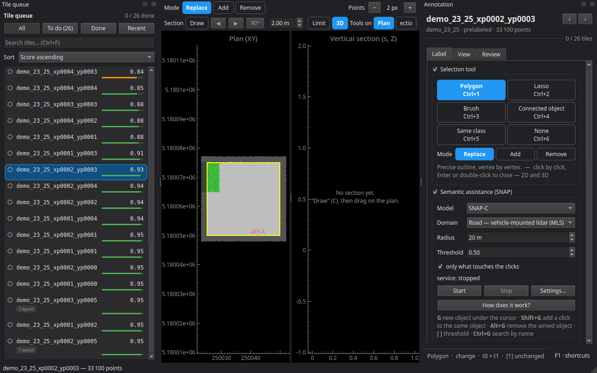

# Annotation

The annotator opens a tile — both its epochs — to correct the pre-labels and fill in what is missing, point by point. Open it with **Open the annotation editor**, below the column when the Annotation stage is selected or in its **Editor** tab, by double-clicking on the tile map, or with `cdforge gui my_project`.

Every change is saved tile by tile as you edit: a crash only loses the gesture in progress. Every action is also written to the tile's log (who, when, what, how many points), and every label set by hand gets the *manual* provenance.

## The window

- **Tile queue**, on the left: all, to do, done, recent; a search (Ctrl+F); a sort order (by score, to start with the most doubtful tiles).
- **The views**, in the middle: the **3D** view, the **plan** (XY) and the **vertical section**. The same selection tools work in all three. In 3D, Ctrl + drag rotates the view whatever the tool; the wheel zooms; the middle button pans.
- **The panel**, on the right, in three tabs: **Label**, **View**, **Review**.

## Label

**Selection tool** — polygon (Ctrl+1), lasso (Ctrl+2), brush (Ctrl+3), connected object (Ctrl+4), same class (Ctrl+5), none — move the view (Ctrl+6). The **mode** says what a gesture does: **Replace**, **Add** to or **Remove** from the selection; **E** toggles removal and back.

**Edit target** — the **layer** (semantic or change, **L** to switch) and the **epoch**.

**Classes** — the list for the active layer; **1** to **9** and **0** pick a class, **A** applies it to the selection. **Digits 1–9, 0** sets what a digit does: **Pick, then A** (the default) or **Apply**, which applies the class as soon as you type the digit; A applies in both cases.

**On the selection** — apply the class (A), select the whole class (S), grow or shrink (+ / −), propagate to the other epoch (T), object change (K), validate auto → manual (V), uncertain (I), unlabelled (U), set points aside from the dataset (Del) and restore them (Shift+Del), clear the selection (Esc), undo and redo.

A point **set aside** (noise, bird, ghost point) is not one more class: it stays on disk, out of the dataset, and can be restored.

### Annotating both dates

A tile has two epochs, and an object that changed reads on both. **T** carries the selection and its class over to the matching points of the other date; **K** shows the change of the selected object; **M** shows its mirror on the other date. The detail: **Help ▸ [Annotating both dates](../../deux_dates.en.md)**.

### SNAP assistance

With the AI module (see [Semantic models](07_ai.md#the-ai-module)), **Start** launches the SNAP service. Then, in the 3D view:

- **G** segments the object under the cursor and proposes its class;
- **Shift+G** adds a click to the same object, to refine it;
- **Alt+G** removes the object under the cursor from the mask;
- **Ctrl+G** looks for a category by name ("pole", "vegetation"…);
- **[** and **]** widen or tighten the mask.

Eight models, for three domains — outdoor, indoor (with colour), aerial. The detail: **Help ▸ [SNAP semantic assistance](../../assistance_snap.en.md)**.

### Ground by cloth simulation

**Classify the ground — CSF…** (Ctrl+Shift+G) opens a window where a cloth falls on a section of the cloud: you see what each setting does, then apply it to the tile. The setting kept is then used to pre-label the other tiles.

**P** grows a region from the point under the cursor.

## View

- **Epochs and colours** — t0, t1 or both; Space switches, Ctrl+B blinks t0 ↔ t1. Colour by change, semantics (fine or coarse classes), the survey's RGB, intensity, height, t0 ↔ t1 distance, label provenance, uncertain points, or points requalified by rays.
- **Displayed classes** — **H** hides or shows the active class again, **Shift+H** shows everything.
- **Clipping** — low and high bounds, for instance to see under the trees.
- **Sensor and rays** — the sensor trajectory, and the rays replayed by **R**.
- **Points** — size (Ctrl++ / Ctrl+−), detail, reset the camera.

The **section** is drawn with **C** in the plan; **,** and **.** shift it by one width.

## Review

- **Tile progress** — what is decided, what is left.
- **To check** — select the auto-filled, unlabelled, uncertain points, or those requalified by rays.
- **Tile-wide corrections**:
  - **Transient changes…** — requalifies as *transient* the added or removed points whose class is transient (vehicle, person…); this is where, not in pre-labelling, that is decided;
  - **Replace a class…** — across the tile (for the whole project: **Project ▸ Project classes ▸ Merge into…**);
  - **Transfer the buffer to neighbouring tiles…** — what was labelled by hand in the buffer goes to the tile where those points are in the core, since the export only keeps cores.
- **Show only** — filters: unlabelled, automatic labels, uncertain, active class, core only, significant change; **Reset the filters**.
- **Tile note**.
- **End of tile** — save (Ctrl+S), mark the tile done, **done and next tile** (Ctrl+D), reopen, reject.

A tile goes through the statuses *tiled → pre-labelled → in progress → done* (or *rejected*). Pre-labelling never touches a tile in progress or done.

## Understanding a label: the R key

On a point of the 3D view, **R** replays the change decision: the measurement, the threshold, coverage, the sensor rays drawn in 3D and in the plan, and the step that decided.

## Shortcuts

**F1** in the annotator shows the full table, read from the program itself.

| Key | Action |
|---|---|
| 1…9, 0 | pick the class |
| A | apply the class |
| S | select the whole class |
| V | validate auto → manual |
| U | unlabelled |
| I | mark uncertain |
| T | propagate to the other epoch |
| K | object change |
| M | mirror on the other date |
| + / − | grow / shrink the selection |
| Esc | clear the selection |
| E | removal mode |
| Del / Shift+Del | set aside / restore points |
| Ctrl+1…6 | selection tool |
| L | switch layer |
| Space / Ctrl+B | switch epoch / blink |
| H / Shift+H | hide the active class / show everything |
| C | draw the section |
| , / . | shift the section |
| P | region growing |
| R | explain the change decision |
| G, Shift+G, Alt+G, Ctrl+G | SNAP assistance |
| [ / ] | SNAP threshold |
| Ctrl+Shift+G | ground by cloth simulation |
| Ctrl++ / Ctrl+− | point size |
| Ctrl+Z / Ctrl+Y | undo / redo |
| Ctrl+S | save |
| Ctrl+D | finish the tile and open the next |
| N / B | next / previous tile |
| Ctrl+F | search a tile |
| Enter | close the polygon |
| F1 | help |

Next step: [Splits](09_splits.md).
