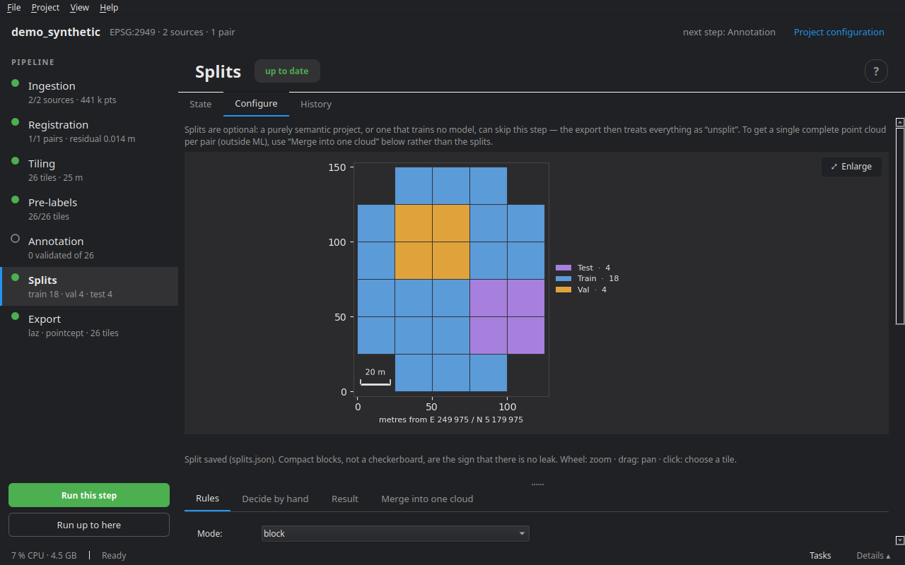

# Splits

To train and evaluate a model, the tiles are shared between **train**, **validation** and **test**. The difficulty is **leakage**: two neighbouring tiles share their buffer, and several pairs can cover the same ground. A tile-by-tile split then puts the same points on both sides, and the test score measures the model's memory, not its ability to generalise.

This stage is optional: a purely semantic project, or one that trains no model, can skip it; the export then treats everything as *unsplit*.

## Modes

| Mode | What it does |
|---|---|
| **block** (default) | spatial blocks of N × N tiles, in absolute coordinates per site: every pair covering the same place falls in the same split |
| **site** | whole sites go to validation or test — the most demanding generalisation test, and the only honest one if the sites differ |
| **random** | one draw per tile: simple, but the same point can end up in train and in test |

## The leakage guard

| Guard | What it does |
|---|---|
| **trim** (default) | buffer points falling in the core of a tile of another split are cropped at export: no shared point, no tile lost |
| **exclude** | any tile touching another split is removed from the dataset: simpler to explain, but whole tiles are lost |
| **none** | no guard |

The guard does not apply in *random* mode: it could not make up for a draw that already mixes neighbouring tiles.

## The Configure tab



A map of the tiles coloured by split, next to four tabs.

**Rules** — the mode; the **share** of each split (normalised if they do not add up to 1; it counts tiles, not points); the **tiles per block** (*block* mode); the **guard**; the **seed**, and **Another draw** to try another one when the split falls badly; the **reserved sites** for validation and test (*site* mode).

**Preview (writes nothing)** shows the split on the map; **Apply and generate** saves it to `splits.json`. Compact blocks, not a checkerboard, are the sign that there is no leak.

**Decide by hand** — click a tile on the map, then pick its split, **Set aside**, or **Return to automatic**; **Apply to the whole block** does the same for the tiles of its block. Decisions are written to `project.yaml` and reapplied at every generation — changing the seed or the shares does not undo them — and the guard protects them like the others.

**Result** — the number of tiles per split, obtained and aimed for, the manual decisions, and the tiles whose buffer will be cropped.

**Merge into one cloud** — reassembles every tile of a pair into a complete t0 cloud and t1 cloud (cores only, no buffer duplicates), with the current labels. Independent of the splits: for using the result outside machine learning (`cdforge merge` on the command line).

## On the command line

```bash
cdforge split my_project
```

Next step: [Export and evaluation](10_export.md).
