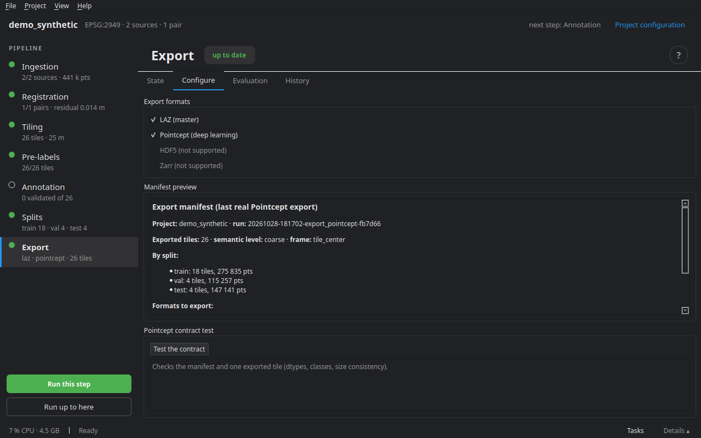

# Export and evaluation

The export writes the dataset, split by split, from the tiles and their current labels. Buffers are cropped according to the guard chosen for the splits: every point appears only once.

## Formats

**Master LAZ** — `exports/laz/<split>/<pair>/<tile>/{t0,t1}.laz`, with every field (classes, change, provenance, confidence, measured distance…), readable in CloudCompare; plus `meta.json` and the tile's annotation log.

**Pointcept** — `exports/pointcept/<split>/<pair>/<tile>/<epoch>/<field>.npy`, ready for a training loader:

- `coord`: float32, in a local frame **shared by both epochs** (the tile centre by default);
- `color`: uint8; `strength`: intensity, normalised by the 1–99 percentiles **of the source** (not of the tile, so that two tiles stay comparable);
- `segment` and `change`: int32, with `ignore_index` (−1) where nothing is decided — by default *unobserved* goes to `ignore`;
- `segment_src`, `change_src`: provenance;
- `manifest.json` sums up the classes, mappings and statistics per split.

Semantics are exported as **coarse classes** by default (`level: coarse`) or as fine classes. The file layout, field names, coordinate frame, change-class mapping and the filter on tile status (for instance exporting only done tiles: `only_status: [done]`) are set in `project.yaml`, `export` section.

## The Configure tab



- **Export formats** — LAZ (master) and Pointcept; at least one.
- **Manifest preview** — what the last run exported (tiles and points per split, semantic level), or what it will.
- **Test the contract** — checks the manifest and one exported tile: `coord` as float32, `segment` as int32 within the announced classes (or `ignore_index`), `change` as long as `coord`. Run it before plugging in a training loader.

## The Evaluation tab

For a project whose tiles carry a **ground truth** — the demo project, or tiles reviewed separately — evaluation compares a predicted field to that field.

- **Ground-truth field** and **predicted field** (by default `gt_change` and `change`), then **Evaluate**.
- **Confusion matrix** — rows: truth, columns: prediction, with each class's recall.
- **Error map by tile** — the error rate (1 − recall) of each tile, on the map.
- **Error map (points)** — each point in green (right) or red (wrong), on one tile or a sample of the project.

The result is written to `reports/evaluation.json`, which the tab reads back when it opens.

## The report

`cdforge report` writes `reports/report.html`: the sources, registration, labels and processing log. The same report opens from **Ingestion ▸ Catalogue ▸ Export the dataset sheet**.

## On the command line

```bash
cdforge export my_project                 # the formats in project.yaml
cdforge export my_project --format laz    # one format only
cdforge evaluate my_project --gt-field gt_change --pred-field change
cdforge report my_project
cdforge history FILE -p my_project        # how a file was produced
```

Next step: [Task manager](11_tasks.md).
