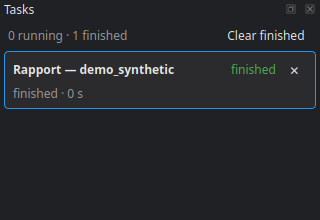

# The task manager

Everything that takes time — ingestion, registration, tiling, pre-labelling, inference, downloading weights, counting classes — runs as a background task. One rule: **a task never blocks the application**. You keep adjusting settings, looking at another stage or opening a tile while it runs, and it survives the view that launched it.

## The panel

The **Tasks** button in the bottom bar, or **Ctrl+T**, shows it; a double-click on its title, or **View ▸ Detach the tasks into a window**, moves it to a window of its own.

For each task: its title, its state (pending, running, finished, stopped, failed), the current phase, the share done and the estimated **time left**.

- **Stop** — asks it to stop; a command that does not answer can be force-closed, after confirmation.
- **Log** — the task's output, and the path of the full log on disk.
- **Remove from the list**, **Clear finished**.

## Quitting during a task

Closing the studio, or changing the language, lists the tasks still running and asks for confirmation: quitting stops them. Running the stage again afterwards redoes what was not finished.

## Stage state

Every finished run is recorded in its stage's **History**: when, how long, its status, metrics and parameters. That record is what tells that a stage is **stale**: its configuration changed since its last successful run. **Project ▸ Refresh the state** (F5) reads it again from disk.

On the command line, `cdforge status` gives tile progress, `cdforge dag` the chaining of the stages, and `cdforge history` the processing chain of a file.

Next step: [The command line](12_command_line.md).
